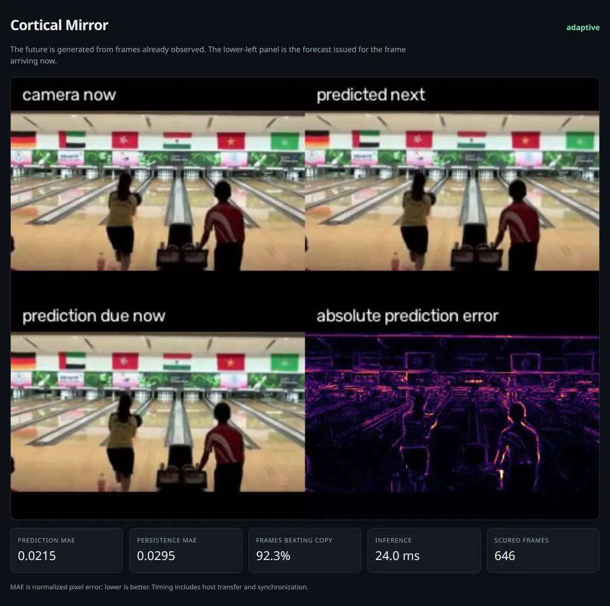
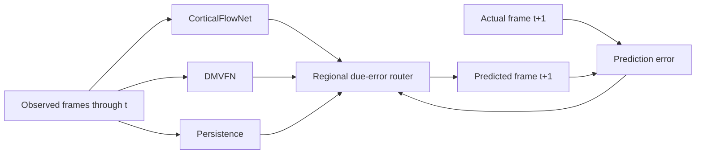

# Cortical Mirror

A live, causal next-frame predictor inspired by hierarchical predictive coding in the visual cortex. Recurrent models propose the future; an online router learns **which predictor to trust in each image region** from errors made by predictions that have already come due.



**Why it is interesting:** it is not a delayed webcam copy or a large diffusion demo. It combines a three-level predictive-coding network, DMVFN's multi-scale voxel flow, and persistence. The adaptive engine won the held-out comparison below while remaining inside a 30 fps frame budget.

**Scientific scope:** this is a functional predictive-coding architecture, not a claim of biological cortical simulation or machine consciousness.

## Architecture



`CorticalFlowNet` has three recurrent representation levels. Each level predicts its next target representation. Signed errors travel upward; recurrent context travels downward. Its fine level predicts forward flow, a bounded appearance residual, and expected correctness. The adaptive router updates regional expert weights only after the corresponding actual frame arrives.

## Quick start

### 1. Install

Python 3.10+ is required. With [`uv`](https://docs.astral.sh/uv/):

```bash
git clone git@github.com:froid1911/cortical-mirror.git
cd cortical-mirror
uv venv
uv pip install --python .venv/bin/python torch --index-url https://download.pytorch.org/whl/cu124
uv pip install --python .venv/bin/python -e '.[dev,dmvfn]'
```

For a CPU-only installation, install the CPU PyTorch wheel instead. The browser demo itself does not require X11.

### 2. Download trained weights

```bash
mkdir -p checkpoints
curl -L -o checkpoints/cortical.pt \
  https://github.com/froid1911/cortical-mirror/releases/download/v0.1.0/cortical-mirror-v0.1.0.pt
curl -L -o checkpoints/dmvfn_vimeo.pkl \
  https://github.com/froid1911/cortical-mirror/releases/download/v0.1.0/dmvfn_vimeo.pkl
```

The cortical checkpoint is the epoch-4 model described below. DMVFN's upstream checkpoint is included for a self-contained download; its license and attribution are in [`THIRD_PARTY_NOTICES.md`](THIRD_PARTY_NOTICES.md).

### 3. Run the mirror

```bash
.venv/bin/cortical-mirror serve \
  --engine adaptive \
  --checkpoint checkpoints/cortical.pt \
  --dmvfn-checkpoint checkpoints/dmvfn_vimeo.pkl \
  --source 0 \
  --host 127.0.0.1 --port 8080
```

Open **http://127.0.0.1:8080**. `--source` accepts a webcam index or a video path. File sources loop by default; use `--no-loop` to stop at EOF.

For a remote server, forward the local port, for example:

```bash
ssh -N -L 8080:127.0.0.1:8080 user@server
```

## Engines

| Engine | Mechanism | When to use it |
|---|---|---|
| `adaptive` | Routes persistence, cortical, and DMVFN predictions by regional due error | Best aggregate quality; the default research demo |
| `cortical` | Three-level recurrent predictive coding with flow-plus-residual rendering | Fastest neural engine and inspectable internal errors |
| `dmvfn` | Dynamic multi-scale voxel flow | Strong standalone motion baseline |
| `flow` | Classical optical flow with online gain adaptation | CPU-only non-neural comparison |
| `copy` | Predicts the current frame as the next frame | Required honesty baseline |

Adaptive experts use FP32 by default because alternating the small models was faster than BF16 on the RTX 3090 benchmark host. Standalone neural engines use BF16 on CUDA unless `--no-amp` is supplied.

Run a standalone engine by changing the factory arguments:

```bash
.venv/bin/cortical-mirror serve \
  --engine cortical --checkpoint checkpoints/cortical.pt --source 0

.venv/bin/cortical-mirror serve \
  --engine dmvfn --checkpoint checkpoints/dmvfn_vimeo.pkl --source 0

.venv/bin/cortical-mirror serve --engine flow --source 0
```

## Held-out results

Protocol: 32 stratified UCF101 validation videos, 16 frames per video, **480 scored transitions** at 256×192. Videos—not clips—were assigned to train/validation splits. Every engine was reset per video. MAE is normalized pixel error; lower is better. Timing excludes the first three calls and includes host transfer and CUDA synchronization.

| Engine | MAE ↓ | SSIM ↑ | Transitions beating copy ↑ | Mean inference ↓ |
|---|---:|---:|---:|---:|
| **Adaptive** | **0.02450** | **0.8690** | **67.9%** | 21.35 ms |
| DMVFN | 0.02699 | 0.8498 | 57.7% | 7.99 ms |
| Cortical | 0.02775 | 0.8473 | 60.2% | 2.26 ms |
| Persistence | 0.02851 | 0.8412 | — | <0.01 ms |

Adaptive does not dominate every individual clip; routing can lag a sudden scene change. The cortical checkpoint was selected at epoch 4: its separate full validation pass measured MAE **0.02033 vs 0.02045** for persistence.

Release assets include per-video reports and a comparison video: **[v0.1.0](https://github.com/froid1911/cortical-mirror/releases/tag/v0.1.0)**.

## Evaluation

Evaluate a single clip and export correctly timestamped samples, a comparison video, and `metrics.json`:

```bash
.venv/bin/cortical-mirror evaluate \
  --engine adaptive \
  --checkpoint checkpoints/cortical.pt \
  --dmvfn-checkpoint checkpoints/dmvfn_vimeo.pkl \
  --source /path/to/clip.mp4 \
  --output artifacts/evaluation \
  --max-frames 120
```

`NNN_pred.png` is always the prediction issued for `NNN_actual.png`; there is no off-by-one pairing. Cold-start and steady-state timings are reported separately.

Reproduce the stratified benchmark with `tools/benchmark.py`:

```bash
.venv/bin/python tools/benchmark.py \
  --engine adaptive \
  --checkpoint checkpoints/cortical.pt \
  --dmvfn-checkpoint checkpoints/dmvfn_vimeo.pkl \
  --data /path/to/UCF-101 \
  --output runs/benchmark-adaptive.json \
  --videos 32 --frames 16
```

Use `CUDA_VISIBLE_DEVICES` to select physical GPUs explicitly.

## Training

UCF101 can be fetched through a mirror that documents conversion of the official archive without altering videos. The published SHA-256 is checked here:

```bash
mkdir -p data
curl -L -o data/UCF-101.zip \
  'https://huggingface.co/datasets/quchenyuan/UCF101-ZIP/resolve/main/UCF-101.zip?download=true'
echo 'eb77e54dfafd9c77e7b086f5e5ef7738cabd16a701b3f5c301a1f6c81fc4756e  data/UCF-101.zip' \
  | sha256sum -c -
unzip data/UCF-101.zip -d data/ucf101
```

Train on natural video:

```bash
.venv/bin/cortical-train \
  --data /path/to/UCF-101 \
  --output runs/ucf-cortical \
  --epochs 6 --max-steps 500 \
  --batch-size 4 --workers 4 \
  --frames 6 --clips-per-video 1 \
  --width 256 --height 192 --channels 24,48,96 \
  --device cuda
```

- `--max-steps 0` removes the per-epoch cap.
- `--resume runs/ucf-cortical/best.pt` resumes model, optimizer, and epoch state.
- Unreadable videos are retried from frame zero and then skipped with a warning, never replaced with fabricated clips.
- Checkpoints use PyTorch's restricted `weights_only` loader; arbitrary checkpoint code is not executed.

Run the behavioral suite:

```bash
.venv/bin/pytest
.venv/bin/ruff check cortical_mirror tests mirror.py tools/benchmark.py
```

Tests cover causal counterfactuals, forward-warp direction, renderer and confidence gradients, checkpoint round-trips, deterministic DMVFN inference, timestamp alignment, corrupt-video recovery, and adaptive expert selection.

## Limitations

- One-step prediction is the target; long-horizon imagination is not claimed.
- Nearly static scenes make persistence unusually hard to beat.
- Pixel warping and expert blending can soften detail; regional routing reduces but does not eliminate this.
- UCF101 is not a webcam distribution. Fine-tune on venue-like footage for deployment.
- There is no explicit object permanence, camera egomotion model, or multimodal future distribution.
- Initial CUDA calls incur a cold-start cost; warm up before measuring or presenting latency.

## License and attribution

Project code is MIT licensed. DMVFN code and checkpoint attribution is preserved in [`THIRD_PARTY_NOTICES.md`](THIRD_PARTY_NOTICES.md). UCF101 is by Khurram Soomro, Amir Roshan Zamir, and Mubarak Shah, *UCF101: A Dataset of 101 Human Action Classes From Videos in the Wild*, CRCV-TR-12-01.
