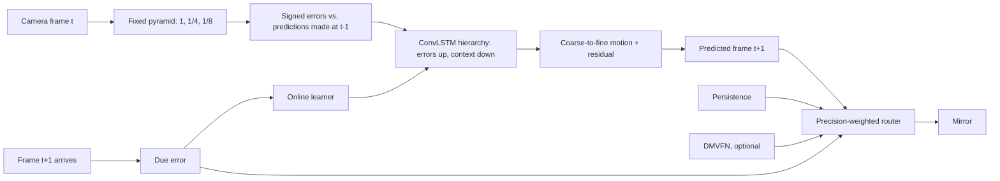

# Cortical Mirror

A live mirror that shows what the camera will see next — and keeps learning to see while you stand in front of it.

A small predictive-coding hierarchy predicts the next webcam frame from the frames it has already seen. Every prediction is scored only against the frame it was issued for, and that error is the only teaching signal: offline on natural video, and online, continuously, on the camera stream in front of it. Started from random weights, it begins as an exact copy of the last frame and, on most scenes we measured, learns within tens of seconds of footage to predict better than that copy.


<sub>Sample footage: “FFSb – Corona LSFB” by the Fédération Francophone des Sourds de Belgique, [CC BY 3.0](https://creativecommons.org/licenses/by/3.0/), via [Wikimedia Commons](https://commons.wikimedia.org/wiki/File:FFSb_-_Corona_LSFB.webm); shown mirrored and as predicted. See [`THIRD_PARTY_NOTICES.md`](THIRD_PARTY_NOTICES.md).</sub>

**Scientific scope:** a functional predictive-coding architecture, not a claim of biological cortical simulation or of machine consciousness.

## What you see

- **The mirror** fills the screen with the *predicted* next frame, flipped like a mirror. The real camera is only a small inset.
- **The surprise curve** plots the mirror's prediction error over minutes against simply repeating the last frame. Started from scratch, you watch it fall below that line.
- **Close its eyes** (space): the camera is cut off and the hierarchy runs on its own predictions. Watch how long its imagined future holds before it drifts; the surprise curve shades those seconds.
- **Look ahead** (1 to 5): show the prediction that many frames into the future, to cancel camera and display latency.
- **What it relies on** (T): colour each region by the predictor the router trusts there, or by the motion the hierarchy expects.
- **Lab view** (Tab): camera, prediction, surprise map, and overlay side by side.

## Prior work, and what is new here

The architecture is a member of a well-known family, and it should be read that way.

- **Rao & Ballard (1999)**, *Predictive coding in the visual cortex*: higher areas predict lower-area activity; only the residual error is passed up.
- **Friston (2005, 2010)**, the free-energy formulation, and **Feldman & Friston (2010)**, *Attention, uncertainty, and free-energy*: prediction errors are weighted by their expected **precision**, i.e. how much each signal should be trusted.
- **PredNet — Lotter, Kreiman & Cox (2017)**, *Deep predictive coding networks for video prediction and unsupervised learning*: a convolutional-LSTM hierarchy in which each layer predicts its input and forwards signed (ReLU-split) errors upward while representations send top-down context. Our `CorticalFlowNet` follows this layout closely.
- **DMVFN — Hu et al. (CVPR 2023)**: a pretrained multi-scale voxel-flow predictor used here as one optional expert, credited in [`THIRD_PARTY_NOTICES.md`](THIRD_PARTY_NOTICES.md).

What this project adds, and tests:

1. **Upper levels that cannot collapse.** In PredNet-style models the target of level *l* is a learned transform of the error below it, so a network can shrink the target to make its own error vanish. Here each level's target is a fixed image pyramid; the three levels must predict the next frame at full, 1/4, and 1/8 resolution. A test asserts the targets have no parameters.
2. **Prediction by motion, coarse to fine.** Every level outputs a displacement increment that refines the coarser level's motion; the image is rendered by warping what was already seen, plus a bounded residual. An untrained network is therefore *exactly* persistence, and anything better than persistence had to be learned.
3. **Learning while it runs.** A background learner trains on windows replayed from the last ten seconds of camera input, with the same due-error loss, and copies improved weights into the live network between frames. A divergence guard rolls back to the last good weights. This is what lets the system learn to see *from scratch* in front of an audience.
4. **Precision-weighted routing.** Each 16 px region estimates, from recent due errors only, how reliable each predictor is, and mixes their forecasts by a softmax over that precision. This is test-time precision weighting in Feldman & Friston's sense, made visible by the trust overlay.
5. **Honest timing.** Nothing ever sees the frame it predicts. Evaluation pairs each prediction with exactly its target frame; tests check this with counterfactual futures.

## Results

All numbers come from files in [`reports/`](reports/), produced by the commands under [Evaluation](#evaluation).

### Test set

Official UCF101 split-1 **test** groups (groups 1–7), 2 videos per action class = 202 videos, 32 frames each, **6,262 scored transitions** at 256×192. UCF101 clips in one group are cut from the same source video, so train, validation (groups 8–9), and test share no source video. Checkpoints and router settings were chosen on validation only; the test split was scored once per engine. MAE is normalized pixel error and LPIPS (Zhang et al., 2018) a learned perceptual distance; lower is better for both.

| Engine | MAE ↓ | vs. persistence | SSIM ↑ | LPIPS ↓ | Transitions beating persistence |
|---|---:|---:|---:|---:|---:|
| Repeat the last frame (persistence) | 0.01806 | — | 0.9027 | 0.0333 | — |
| Classical optical flow, Farnebäck | 0.01945 | -7.7% | 0.8930 | 0.0720 | 32.6% |
| DMVFN, pretrained third-party model | 0.01649 | +8.7% | 0.9152 | 0.0328 | 61.4% |
| **Cortical hierarchy alone** | 0.01494 | +17.3% | 0.9259 | 0.0325 | 69.7% |
| Router: persistence + flow | 0.01662 | +7.9% | 0.9141 | 0.0409 | 58.5% |
| Router: persistence + DMVFN | 0.01502 | +16.8% | 0.9254 | 0.0324 | 67.2% |
| **Router: persistence + cortical** | 0.01481 | +18.0% | 0.9260 | 0.0322 | 75.1% |
| Router: cortical + DMVFN | 0.01459 | +19.2% | 0.9291 | 0.0333 | 69.2% |
| **Router: persistence + cortical + DMVFN** | 0.01443 | +20.1% | 0.9295 | 0.0331 | 73.3% |

The hierarchy has 720 k parameters, learned only by predicting UCF101 video. Alone, it predicts with 17.3% less error than persistence, about twice the 8.7% of the pretrained DMVFN. Routed with persistence and no third-party model at all, it beats persistence + DMVFN. Adding DMVFN on top still helps a little. Perceptual distance barely moves for any method: one-frame warps soften fine texture, and LPIPS penalises that about as much as it rewards correct motion.

On an RTX 3090 the hierarchy alone takes about 3 ms per frame and the full three-expert mirror about 13 ms without learning, 18 ms with it. Timings in the report files were measured while other jobs shared the GPU, so treat them as upper bounds. Router temperature and adaptation were chosen on the validation split (`reports/tune/`), and every router above uses the same settings.

### Learning from scratch, live

`tools/live_learning.py` chains consecutive clips of one test-set source video (20–35 s of one scene) and feeds them, frame by frame, to an **untrained** hierarchy that learns online from replayed windows of the stream. It runs the learner at the rate the live mirror sustains on an RTX 3090 — 0.5 gradient steps per camera frame (about 15 steps/s while inference stays near 18 ms) — but steps it synchronously, so the result does not depend on thread timing. The ratio is the mirror's error divided by the error of repeating the last frame, per 5-second window; below 1 is better than persistence.

| Scene (test split) | Footage | First 5 s | Last 5 s | Second half | Rollbacks |
|---|---:|---:|---:|---:|---:|
| ApplyEyeMakeup g04 | 35 s | 1.14 | 0.98 | 0.96 | 0 |
| Archery g01 | 30 s | 1.07 | 0.96 | 0.94 | 0 |
| BalanceBeam g06 | 25 s | 1.11 | 0.82 | 0.93 | 2 |
| BandMarching g01 | 35 s | 0.90 | 0.86 | 0.93 | 0 |
| BaseballPitch g03 | 20 s | 1.05 | 1.03 | 1.05 | 0 |
| Basketball g01 | 30 s | 1.57 | 1.09 | 1.10 | 2 |
| **All six, pooled** | | | | **0.95** | |

The frozen untrained network scores exactly 1.00 on every window: it *is* persistence. Learning only from the stream, it ends 5% below persistence error overall within 20–35 seconds of footage and better than persistence on four of six scenes; on the two fast, cluttered sports scenes it stays worse. With a full step per frame (a faster GPU, or a smaller image) the same experiment reaches 10% (`reports/live-scratch-v4.json`). Before the cell-state bound and burn-in were added, one scene diverged to 6× persistence error (`reports/live-scratch-lr1e-3.json`); the bound and the rollback guard now prevent that, and every rollback is counted above.

**After pretraining, live learning adds little on these clips.** The trained hierarchy, frozen, is 23% below persistence on the same continuous scenes and stays stable for over a thousand frames; fine-tuning it live for 20–35 s changes that by less than one percentage point (`reports/live-pretrained-G*.json`). Its value is adapting to what UCF101 does not contain — a particular room, camera, and lighting — which needs the webcam test set below to measure.

### The panning test

`tools/pan_probe.py` slides a natural-statistics texture 3 px per frame to the right and reads off the motion the hierarchy predicts. Version 0.1 predicted about 0.05 px — effectively a copy of the last frame.

| | Predicted motion | Error vs. persistence |
|---|---:|---:|
| v0.1 cortical network | ≈ 0.05 px | ≈ equal |
| v0.2 cortical network | **1.75 px** of 3 px | **47% lower** |

It underestimates a 3 px pan, plausibly because typical UCF101 motion at this resolution is about 1 px per frame (validation teacher flow averages 1.1 px).

## Quick start

Python 3.10+.

```bash
git clone git@github.com:froid1911/cortical-mirror.git
cd cortical-mirror
uv venv && uv pip install --python .venv/bin/python -e '.[dev,eval]'
.venv/bin/cortical-mirror demo
```

Open **http://127.0.0.1:8080**. `demo` downloads the weights and DMVFN checkpoint to `~/.cache/cortical-mirror` on first use, opens camera 0, and turns live learning on. Without a camera it plays a 22-second sample clip of a person signing in Belgian French Sign Language, chosen because it looks like someone standing in front of a mirror: an untrained hierarchy learns it to about 27% below persistence error within a minute of live learning. Without CUDA it runs on the CPU, routes between persistence and the hierarchy only (≈ 26 ms per frame on a 12-thread laptop CPU), and turns live learning off, because a CPU learner cannot keep up; install the CUDA build of PyTorch for DMVFN and live learning. On an RTX 3090 the full mirror with live learning runs at 30 fps with about 18 ms inference per frame.

```bash
.venv/bin/cortical-mirror demo --from-scratch     # start untrained and watch it learn
.venv/bin/cortical-mirror demo --source clip.mp4  # any video file
.venv/bin/cortical-mirror demo --horizon 3        # show three frames ahead
```

Append `?view=lab` to the URL to open the lab view directly, for example on a second screen.

Until the v0.2.0 release assets are published, place `cortical.pt` (the trained hierarchy) and `dmvfn_vimeo.pkl` in `~/.cache/cortical-mirror` yourself, or run `demo --from-scratch` (which still needs `dmvfn_vimeo.pkl` on CUDA; the v0.1.0 release has it).

### Controls

| Key | Action |
|---|---|
| Space | Close or open its eyes |
| T | Show what it relies on |
| 1–5 | Look that many frames ahead |
| L | Pause or resume learning |
| R | Forget what it learned here |
| Tab | Switch between mirror and lab view |
| F | Full screen |

## Architecture



Each `CorticalFlowNet` level receives the positive and negative parts of its last prediction error, its current input, and the change since the last frame. Cell states are soft-bounded so that minutes of continuous input cannot drive them into saturation, and the network is trained from a recurrent state already settled on earlier frames ("burn-in"), the regime a live camera keeps it in.

## Engines

| Engine | Mechanism |
|---|---|
| `adaptive` | Precision-weighted routing between `--experts` (default `copy,cortical,dmvfn`; `flow` also available) |
| `cortical` | The predictive-coding hierarchy alone |
| `dmvfn` | Pretrained dynamic multi-scale voxel flow |
| `flow` | Classical Farnebäck optical flow, extrapolated |
| `copy` | Repeat the current frame: the required honesty baseline |

`--learn` keeps training the hierarchy on the stream; `--from-scratch` starts it untrained (and implies `--learn`). `--device auto` (the default) uses CUDA when present and the CPU otherwise.

```bash
.venv/bin/cortical-mirror serve --engine adaptive \
  --checkpoint ~/.cache/cortical-mirror/cortical.pt \
  --dmvfn-checkpoint ~/.cache/cortical-mirror/dmvfn_vimeo.pkl \
  --learn --source 0
```

## Evaluation

```bash
# Test split, one engine (repeat per engine / expert set)
.venv/bin/python tools/benchmark.py --data /path/to/UCF-101 --split test --lpips \
  --engine adaptive --experts copy,cortical,dmvfn \
  --checkpoint cortical.pt --dmvfn-checkpoint dmvfn_vimeo.pkl --output reports/test-adaptive.json

# Learning from scratch on continuous scenes
.venv/bin/python tools/live_learning.py --data /path/to/UCF-101 --scenes 6 \
  --learn-rate 1e-3 --output reports/live-scratch.json

# The panning test
.venv/bin/python tools/pan_probe.py --checkpoint cortical.pt
```

`benchmark.py` refuses `--learn`: the live learner runs on its own thread, so its effect is measured with `live_learning.py`, which steps it synchronously.

### Your own webcam test set

UCF101 is not a webcam. Record fresh clips before tuning anything on them, then score every engine on all of them:

```bash
.venv/bin/python tools/record.py --output data/webcam-test --clips 10 --seconds 10
.venv/bin/python tools/benchmark.py --data data/webcam-test --split all --frames 300 \
  --engine adaptive --checkpoint cortical.pt --dmvfn-checkpoint dmvfn_vimeo.pkl \
  --output reports/webcam-adaptive.json
```

## Training

UCF101 can be fetched through a mirror that documents conversion of the official archive without altering videos. The published SHA-256 is checked here:

```bash
mkdir -p data
curl -L -o data/UCF-101.zip \
  'https://huggingface.co/datasets/quchenyuan/UCF101-ZIP/resolve/main/UCF-101.zip?download=true'
echo 'eb77e54dfafd9c77e7b086f5e5ef7738cabd16a701b3f5c301a1f6c81fc4756e  data/UCF-101.zip' \
  | sha256sum -c -
unzip data/UCF-101.zip -d data/ucf101
```

Train the released model (8 epochs, about 6 hours on one RTX 3090):

```bash
.venv/bin/cortical-train \
  --data data/ucf101/UCF-101 --output runs/cortical \
  --epochs 8 --batch-size 8 --workers 11 --lr 1e-3 \
  --frames 10 --burn-in 16 --clips-per-video 6 --validation-videos 512 \
  --channels 24,48,96 --width 256 --height 192
```

- The split assigns whole UCF101 groups: test = official split-1 test groups 1–7, validation = groups 8–9, train = the rest. The test split is never loaded by training.
- `--burn-in N` runs N frames without gradient before each training clip.
- `--flow-teacher W` adds a Farnebäck-flow distillation term that decays linearly to zero, so the final epochs are purely self-supervised. Validation always reports flow endpoint error against the teacher as a diagnostic of whether motion is being learned.
- The best checkpoint is selected on validation pixel MAE.
- Checkpoints load through PyTorch's restricted `weights_only` loader.

```bash
.venv/bin/pytest
.venv/bin/ruff check cortical_mirror tests tools mirror.py
```

Tests cover causal counterfactuals, forward-warp direction, the group-disjoint split, teacher-flow sign convention, non-collapsing targets, learning a pan from scratch (offline and online), rollback on divergence, bounded cell states over long runs, routing, timestamp alignment, and checkpoint round-trips.

## Limitations

- Only one-step prediction is scored. Multi-step rollouts ("eyes closed", look-ahead) are shown in the demo but not evaluated quantitatively.
- UCF101 is not a webcam, and the hierarchy is small and runs at 256×192. Live learning is meant to adapt to one room, but that has not yet been measured on webcam footage; record a test set with `tools/record.py`.
- From scratch, the hierarchy is briefly *worse* than persistence while its first motion estimates are wrong, before it improves. Two of six measured scenes (fast, cluttered sports footage) did not get below persistence within their 20–30 s.
- There is no object permanence, explicit egomotion, or multimodal future; pixel warping and blending can soften detail.
- The pretrained DMVFN expert is not part of the self-organizing story; ablations without it are reported.

## Changes since v0.1

v0.1's evaluation split clips, not source videos, between training and validation, and its checkpoint and router settings were chosen on the reported videos; its "held-out" numbers were validation numbers on videos that shared sources with training. Its cortical network also predicted almost no motion (MAE 0.0199 vs 0.0199 for persistence; ~0.05 px on a 3 px pan), so the gains came from DMVFN and blending. v0.2 rebuilds the hierarchy, the split, the evaluation, and the demo around those findings.

## License and attribution

Project code is MIT licensed. DMVFN code and checkpoint attribution is preserved in [`THIRD_PARTY_NOTICES.md`](THIRD_PARTY_NOTICES.md). UCF101 is by Khurram Soomro, Amir Roshan Zamir, and Mubarak Shah, *UCF101: A Dataset of 101 Human Action Classes From Videos in the Wild*, CRCV-TR-12-01.

### References

- R. P. N. Rao and D. H. Ballard. Predictive coding in the visual cortex. *Nature Neuroscience* 2, 79–87, 1999.
- K. Friston. A theory of cortical responses. *Phil. Trans. R. Soc. B* 360, 815–836, 2005.
- K. Friston. The free-energy principle: a unified brain theory? *Nature Reviews Neuroscience* 11, 127–138, 2010.
- H. Feldman and K. Friston. Attention, uncertainty, and free-energy. *Frontiers in Human Neuroscience* 4, 215, 2010.
- W. Lotter, G. Kreiman, and D. Cox. Deep predictive coding networks for video prediction and unsupervised learning. *ICLR*, 2017.
- X. Hu, Z. Huang, A. Huang, J. Xu, and S. Zhou. A dynamic multi-scale voxel flow network for video prediction. *CVPR*, 2023.
- R. Zhang, P. Isola, A. A. Efros, E. Shechtman, and O. Wang. The unreasonable effectiveness of deep features as a perceptual metric. *CVPR*, 2018.
- G. Farnebäck. Two-frame motion estimation based on polynomial expansion. *SCIA*, 2003.
