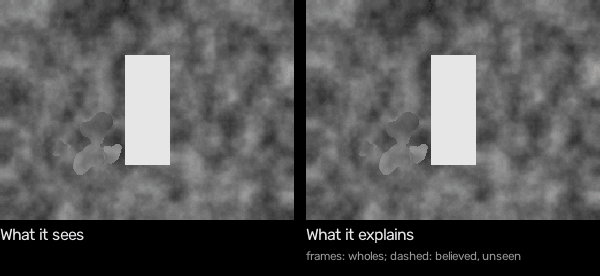
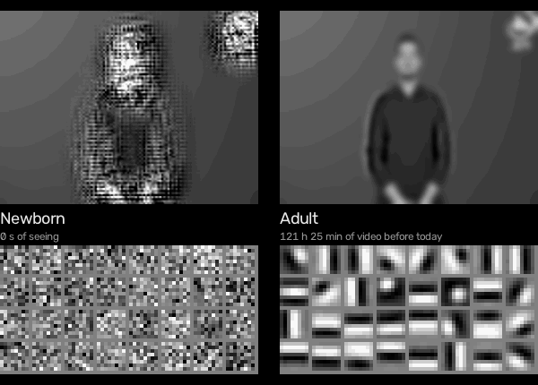
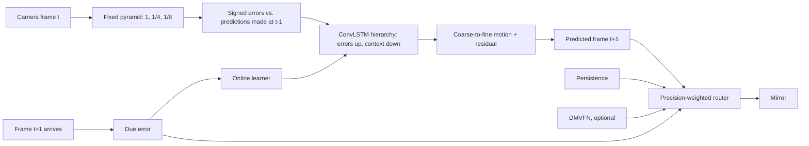

# Cortical Mirror

A live mirror that shows what the camera will see next — and keeps learning to see while you stand in front of it.

A small predictive-coding hierarchy predicts the next webcam frame from the frames it has already seen. Every prediction is scored only against the frame it was issued for, and that error is the only teaching signal: offline on natural video, and online, continuously, on the camera stream in front of it. Started from random weights, it begins as an exact copy of the last frame. On a person moving in front of a still camera it learns, within about a minute, to predict better than that copy; on short, generic action clips it ends about even with it.

**New in v0.10:** [objects from learned motion](#v010-objects-from-learned-motion). Objects are found as what moves together, by the motion cells the cortex learned, and held through pauses by links learned from common fate. A scene of these learned objects, with a memory of the background, can be edited: deleting an object shows what was behind it at 0.24 × a bitmap's error, moving one at 0.59 × (protocol 22). Their masks are still coarse: object IoU stays near 0.3, and the reports show where spatial precision is lost.

**New in v0.9:** faster motion cells. With more types and faster training motion, they cover 7 of 8 directions at fast speeds (v0.7: 4). The learned self/world separation now passes at the original, larger saccades: 0.145 against 0.72 ([reports](reports/scene/README.md)).

**New in v0.8:** [self and world in one learned code](#v08-self-and-world-in-learned-motion). The eye's own command is told to the learned motion cells, and a map learned by Hebbian averaging says which cells each command makes active. The cortex then explains away 98% of the motion its own saccades cause, while the same shift without a command is seen as the world moving. The newborn cannot tell the two apart.

**New in v0.7:** [motion, learned](#v07-motion-learned). Motion cells learn from video, with no motion detector built in. On fresh UCF101 test clips, real video is now predicted from motion the cortex itself learned: 0.88 × the error of repeating the last frame. Silencing those cells removes all motion from the prediction.

**New in v0.6:** [real video, predicted from moving parts](#v06-real-video-from-moving-parts). On fresh UCF101 test clips the scene level now predicts the next frame at 0.77 × the error of repeating the last frame, better on 95% of clips. The adult also keeps hidden objects. Much of this rests on engineered parts, labelled as such below. v0.7 turns back to learning them.

**New in v0.5:** [parts and wholes, light, real video and a GPU](#v05-parts-and-wholes-light-real-video-gpu). Pieces that move together become one creature you can delete in one click. Objects survive changes of light, the camera's own motion is registered away, and the graph's search runs on a GPU. Of the five v0.5 protocol runs, one passes and four fail; see the table.

**New in v0.4:** [the world as a scene graph](#the-world-as-a-scene-graph-v04). It explains what it sees as things: a remembered background, and objects with a shape, a place, a motion and a depth. The eye is one of its nodes. Edit the graph, by deleting an object or moving it, and it renders what the world would look like then. `cortical-mirror scene` runs it in your browser.



<sub>The sprite world. Rings are the graph's objects; a dashed ring is one it believes in but cannot see, an orange ring one deleted from the picture.</sub>

**New in v0.3:** a [visual cortex that learns to see with local rules only](#a-cortex-that-learns-to-see-research-track), shown as twin mirrors. A newborn starts blank in front of your camera, beside an adult that learned with the same rules from 121 hours of video. `cortical-mirror twins` runs it.



<sub>The newborn's first 2 minutes of seeing, sped up after the first seconds. Top: what each expects to see next; bottom: what its cells respond to. Sample footage: “FFSb – Corona LSFB” by the Fédération Francophone des Sourds de Belgique, [CC BY 3.0](https://creativecommons.org/licenses/by/3.0/), via [Wikimedia Commons](https://commons.wikimedia.org/wiki/File:FFSb_-_Corona_LSFB.webm); shown mirrored and as predicted. See [`THIRD_PARTY_NOTICES.md`](THIRD_PARTY_NOTICES.md).</sub>

**Scientific scope:** a functional predictive-coding architecture, not a claim of biological cortical simulation or of machine consciousness.

## What you see


<sub>The v0.2 mirror on the same sample footage.</sub>

- **The mirror** fills the screen with the *predicted* next frame, flipped like a mirror. The real camera is only a small inset.
- **The surprise curve** plots the mirror's prediction error over minutes against simply repeating the last frame. Started from scratch, you watch it fall below that line.
- **Close its eyes** (space): the camera is cut off and the hierarchy runs on its own predictions. Watch how long its imagined future holds before it drifts; the surprise curve shades those seconds.
- **Look ahead** (1 to 5): show the prediction that many frames into the future, to cancel camera and display latency.
- **What it relies on** (T): colour each region by the predictor the router trusts there, or by the motion the hierarchy expects.
- **Lab view** (Tab): camera, prediction, surprise map, and overlay side by side.

## Prior work, and what is new here

The architecture is a member of a well-known family, and it should be read that way.

- **Rao & Ballard (1999)**, *Predictive coding in the visual cortex*: higher areas predict lower-area activity; only the residual error is passed up.
- **Friston (2005, 2010)**, the free-energy formulation, and **Feldman & Friston (2010)**, *Attention, uncertainty, and free-energy*: prediction errors are weighted by their expected **precision**, i.e. how much each signal should be trusted.
- **PredNet — Lotter, Kreiman & Cox (2017)**, *Deep predictive coding networks for video prediction and unsupervised learning*: a convolutional-LSTM hierarchy in which each layer predicts its input and forwards signed (ReLU-split) errors upward while representations send top-down context. Our `CorticalFlowNet` follows this layout closely.
- **DMVFN — Hu et al. (CVPR 2023)**: a pretrained multi-scale voxel-flow predictor used here as one optional expert, credited in [`THIRD_PARTY_NOTICES.md`](THIRD_PARTY_NOTICES.md).

What this project adds, and tests:

1. **Upper levels that cannot collapse.** In PredNet-style models the target of level *l* is a learned transform of the error below it, so a network can shrink the target to make its own error vanish. Here each level's target is a fixed image pyramid; the three levels must predict the next frame at full, 1/4, and 1/8 resolution. A test asserts the targets have no parameters.
2. **Prediction by motion, coarse to fine.** Every level outputs a displacement increment that refines the coarser level's motion; the image is rendered by warping what was already seen, plus a bounded residual. An untrained network is therefore *exactly* persistence, and anything better than persistence had to be learned.
3. **Learning while it runs.** A background learner trains on windows replayed from the last ten seconds of camera input, with the same due-error loss, and copies improved weights into the live network between frames. A guard rolls back to the last good weights when replayed or live error climbs far above persistence. This is what lets the system learn to see *from scratch* in front of an audience; what made long runs stable was bounding the cell state and training from a settled state (burn-in), and the guard only caps the worst cases (see below).
4. **Precision-weighted routing.** Each 16 px region estimates, from recent due errors only, how reliable each predictor is, and mixes their forecasts by a softmax over that precision. This is test-time precision weighting in Feldman & Friston's sense, made visible by the trust overlay.
5. **Honest timing.** Nothing ever sees the frame it predicts. Evaluation pairs each prediction with exactly its target frame; tests check this with counterfactual futures.

## Results

All numbers come from files in [`reports/`](reports/), produced by the commands under [Evaluation](#evaluation).

### Test set

Official UCF101 split-1 **test** groups (groups 1–7), 2 videos per action class = 202 videos, 32 frames each, **6,262 scored transitions** at 256×192. UCF101 clips in one group are cut from the same source video, so train, validation (groups 8–9), and test share no source video. Checkpoints and router settings were chosen on validation only. Every engine in the table was scored once in its final form; in addition, a mid-training snapshot of the final model was scored once (`reports/test-G-ep1-*`), the two baseline routers were first scored with the earlier, untuned settings before being re-scored with the validation-tuned ones shown here, and the live-learning settings below were developed on six test scenes, which is why the live-learning results use twelve different ones. MAE is normalized pixel error and LPIPS (Zhang et al., 2018) a learned perceptual distance; lower is better for both.

| Engine | MAE ↓ | vs. persistence | SSIM ↑ | LPIPS ↓ | Transitions beating persistence |
|---|---:|---:|---:|---:|---:|
| Repeat the last frame (persistence) | 0.01806 | — | 0.9027 | 0.0333 | — |
| Classical optical flow, Farnebäck | 0.01945 | -7.7% | 0.8930 | 0.0720 | 32.6% |
| DMVFN, pretrained third-party model | 0.01649 | +8.7% | 0.9152 | 0.0328 | 61.4% |
| **Cortical hierarchy alone** | 0.01494 | +17.3% | 0.9259 | 0.0325 | 69.7% |
| Router: persistence + flow | 0.01662 | +7.9% | 0.9141 | 0.0409 | 58.5% |
| Router: persistence + DMVFN | 0.01502 | +16.8% | 0.9254 | 0.0324 | 67.2% |
| **Router: persistence + cortical** | 0.01481 | +18.0% | 0.9260 | 0.0322 | 75.1% |
| Router: cortical + DMVFN | 0.01459 | +19.2% | 0.9291 | 0.0333 | 69.2% |
| **Router: persistence + cortical + DMVFN** | 0.01443 | +20.1% | 0.9295 | 0.0331 | 73.3% |

The hierarchy has 720 k parameters, learned only by predicting UCF101 video. Alone, it predicts with 17.3% less error than persistence, about twice the 8.7% of the pretrained DMVFN. That gap is solid: 8.6 points, with a paired-bootstrap 95% interval of 5.4 to 12.2 points over videos, and lower error on 133 of 202 videos (`reports/compare-cortical-vs-dmvfn.json`). DMVFN was trained on Vimeo-90K, not UCF101, so some of its deficit may be domain shift. Routed with persistence and no third-party model at all, the hierarchy is level with persistence + DMVFN: 1.2 points ahead, but the interval (−0.1 to 2.4 points) includes zero and it wins on 123 of 202 videos (`reports/compare-copy-cortical-vs-copy-dmvfn.json`). Adding DMVFN on top still helps a little. Perceptual distance barely moves for any method: one-frame warps soften fine texture, and LPIPS penalises that about as much as it rewards correct motion.

On an RTX 3090 the hierarchy alone took 3.1 ms per frame in the benchmark above. Fed at camera rate, the three-expert mirror takes 11.3 ms per frame without learning and 17.1 ms while the learner runs about 14 steps per second beside it (`reports/latency-rtx3090.json`). On a 12-thread laptop CPU (AMD Ryzen AI 9 HX 370 w/ Radeon 890M) the trained hierarchy with persistence takes 31.5 ms per frame (`reports/latency-laptop-cpu.json`). Router temperature and adaptation were chosen on the validation split (`reports/tune/`), and every router above uses the same settings.

### Learning from scratch, live

`tools/live_learning.py` chains consecutive clips of one test-set source video (18–66 s of one scene) and feeds them, frame by frame, to an **untrained** hierarchy that learns online from replayed windows of the stream. It steps the learner synchronously at 0.5 steps per frame; the live mirror sustains 0.6–0.7 on an RTX 3090 (`reports/latency-rtx3090.json`). Ratios are the mirror's error divided by the error of repeating the last frame, per 150-frame window (6 s at UCF101's 25 fps); below 1 is better than persistence. These twelve scenes were never used while developing the learner (`--offset 6 --scenes 12`).

| Scene (test split) | Footage | First window | Last window | Second half | Rollbacks | Second half without guard |
|---|---:|---:|---:|---:|---:|---:|
| BasketballDunk g01 | 18 s | 1.06 | 0.94 | 0.95 | 0 | 0.98 |
| BenchPress g02 | 24 s | 1.08 | 0.91 | 0.93 | 0 | 0.93 |
| Biking g02 | 50 s | 1.03 | 1.01 | 1.00 | 0 | 1.00 |
| Billiards g02 | 66 s | 1.65 | 1.04 | 1.16 | 19 | 1.04 |
| BlowDryHair g06 | 48 s | 1.02 | 0.99 | 0.98 | 0 | 0.99 |
| BlowingCandles g06 | 36 s | 1.19 | 0.91 | 0.93 | 0 | 0.92 |
| Bowling g01 | 36 s | 0.98 | 0.99 | 0.96 | 0 | 0.97 |
| BoxingPunchingBag g01 | 42 s | 1.24 | 0.92 | 0.92 | 1 | 0.88 |
| BoxingSpeedBag g04 | 54 s | 1.06 | 1.34 | 1.30 | 0 | 1.47 |
| BrushingTeeth g02 | 66 s | 1.67 | 1.68 | 1.27 | 4 | 2.77 |
| CliffDiving g05 | 18 s | 1.02 | 0.78 | 0.95 | 0 | 1.16 |
| CricketBowling g01 | 24 s | 1.47 | 1.02 | 1.07 | 0 | 1.09 |
| **All twelve, pooled** | | | | **1.02** | | **1.06** |

The frozen untrained network scores exactly 1.00 on every window: it *is* persistence. Learning only from these short, varied action clips, it ends about even with persistence (1.02 pooled) and better on 7 of 12 scenes. The six scenes used during development looked better (0.95 pooled, `reports/live-scratch-realtime-lr1e-3.json`), which is exactly why the held-out numbers are the ones reported.

Long continuous runs were made stable by bounding the cell state and training from a settled state: before those changes one development scene diverged to 6× persistence error **without triggering a single rollback** (`reports/live-scratch-guard.json`). The guard is a safety net, not the fix. With it off (last column, `reports/live-scratch-heldout-noguard.json`), the worst scene reaches 2.8× instead of 1.3× and the pooled ratio is 1.06; on one scene (Billiards) its 19 rollbacks made things worse.

**The sample clip is where it works.** On the 22-second sign-language clip that ships with the release (a person facing a still camera), `tools/live_learning.py --video sample.mp4 --loop 3` measures 1.11× persistence error in the first 6 s, 0.87× by the end of the first pass (19 s), and 0.72–0.76× after about a minute, by which point the learner has seen the clip repeat (`reports/live-scratch-sample.json`).

**After pretraining, live learning adds little on these clips.** The trained hierarchy, frozen, is 23% below persistence on the same continuous scenes and stays stable for over a thousand frames; fine-tuning it live for 20–35 s changes that by less than one percentage point (`reports/live-pretrained-G*.json`). Its value is adapting to what UCF101 does not contain — a particular room, camera, and lighting — which needs the webcam test set below to measure.

### The panning test

`tools/pan_probe.py` slides a natural-statistics texture 3 px per frame to the right and reads off the motion the hierarchy predicts. Version 0.1 predicted about 0.05 px — effectively a copy of the last frame.

| | Predicted motion | Error vs. persistence |
|---|---:|---:|
| v0.1 cortical network | ≈ 0.05 px | ≈ equal |
| v0.2 cortical network | **1.75 px** of 3 px | **47% lower** |

It underestimates a 3 px pan, plausibly because typical UCF101 motion at this resolution is about 1 px per frame (validation teacher flow averages 1.1 px).

## A cortex that learns to see (research track)

The mirror above is good engineering: a network trained by backpropagation on 8,000 videos. It is not how a brain learns. This research track asks a different question, in the spirit of "something that learns to see like cortex from scratch": can a predictive-coding hierarchy that learns **only with local rules** develop what a real visual cortex is known to do, by itself?

Progress is judged by **phenomena that emerge**, measured with the stimuli neuroscience used. Each protocol is written down in [`docs/protocols/`](docs/protocols/) before its first measurement, with its pass criterion, and failures are reported. Nothing is fitted to brain recordings.

### The rules

1. **No backpropagation, and no weight transport.** Every connection changes by the product of the activities at its two ends and the error its cell carries. Feedback weights never read the forward weights. They start unrelated and converge by receiving the same local update (Kolen & Pollack, 1994). The code never uses automatic differentiation, and a test enforces it.
2. **Innate structure only where biology has it at birth.**
   - Built in: a retina-like front end (centre-surround ON/OFF cells, contrast normalisation, lagged cells), small receptive fields, a coarse-to-fine layout, homeostatic set points, and the reflex "look toward surprise".
   - Not built in: edge filters, orientations, directions, or where to look.
3. **The newborn learns only from its own stream, and the adult learns with exactly the same rules.** In 3 hours of training, each adult watched 36–121 hours of UCF101 training video (25 fps): 121 h in phase 1, 77 h in phase 2, 36 h in phase 3. Later phases are slower per step.
4. **Phenomena are measured, not eyeballed**, with criteria fixed in advance.
5. **Edge cells are a first check, not the result.** Many learning methods produce them.

**Declared simplification:** weights are shared across positions (convolution). That is like every location learning from the same statistics, rather than each one learning separately as in biology.

### What it is

- **Retina.** Luminance at 128 × 96 becomes an ON/OFF code. From phase 2 it also has lagged cells, which carry the previous frame.
- **V1.** 32 cell types settle to explain the retinal code with as few active cells as possible (sparse coding; Olshausen & Field, 1996).
- **V2** (from phase 2). V2 learns to predict V1, and V1 is pulled toward that prediction (Rao & Ballard, 1999).
- **Temporal prediction.** Every level predicts its own next activity, learning by a normalised delta rule.
- **Eye** (phase 3). The cortex sees a foveal window of a larger view. A coarse periphery, learning by the same rules, signals surprise, and the eye saccades toward it, avoiding recent fixations. Each movement has its own learned temporal kernel. The cortex is told which movement is about to happen (an efference copy), but nothing about the resulting image shift is built in.

Two instances of the same network run as **twin mirrors**: a **newborn** that starts blank in front of the camera, and an **adult**. Watching the newborn's cells turn into the adult's is the demo.

### Results

| Phenomenon (protocol) | Verdict |
|---|---|
| Orientation-tuned cells, like V1 (1) | **Emerges.** The newborn reaches 88–94% selective cells within 2 minutes of video; the adult 97%. |
| Repetition suppression and mismatch (2) | **Emerges,** with a caveat: an untrained network that learns during the sequence already shows much of it. |
| Direction-selective cells (3) | **Fails.** Learning removes the few the untrained network has. |
| Surround suppression from feedback (4) | **Fails.** Suppression is strong, but just as strong without feedback, so it comes from competition within V1. |
| End-stopping from feedback (5) | **Fails,** for the same reason. |
| Predictive remapping with an efference copy (6) | **Emerges in the adult.** Prediction error after a saccade drops to 0.40 with the copy, and the kernels are direction-specific (0.51). |
| Habituation of orienting (7) | **Fails.** The eye stays drawn to predictable motion. Inhibition of return works (revisits 0.00 vs 0.20 by chance). |

The tables below are generated from the report files by `tools/cortex_report.py`, which applies each protocol's pre-declared criterion.

#### Phase 1, protocol 1: orientation tuning

| Condition | Median OSI | Cells with OSI > 0.3 | Protocol 1 |
|---|---:|---:|---|
| Untrained | 0.09 | 38% | – |
| Newborn, 2 min of the sample clip | 0.48 | 88% | pass |
| Newborn, 2 min of a held-out UCF101 scene | 0.64 | 94% | pass |
| Adult | 0.74 | 97% | pass |

#### Phase 1, protocol 2: oddball adaptation

| Condition | iRS (repetition suppression) | iPE (prediction error) | iMM (mismatch) | Protocol 2 |
|---|---:|---:|---:|---|
| Untrained | +0.32 | +0.31 | +0.63 | – |
| Newborn, 2 min of the sample clip | +0.45 | +0.34 | +0.80 | pass |
| Newborn, 2 min of a held-out UCF101 scene | +0.45 | +0.34 | +0.79 | pass |
| Adult | +0.44 | +0.33 | +0.77 | pass |

#### Phase 2, protocol 3: direction selectivity

| Condition | Median DSI | Cells with DSI > 0.3 | Protocol 3 |
|---|---:|---:|---|
| Untrained | 0.12 | 19% | – |
| Newborn, 2 min of the sample clip | 0.07 | 9% | **fail** |
| Newborn, 2 min of a held-out UCF101 scene | 0.00 | 0% | **fail** |
| Adult | 0.01 | 0% | **fail** |

#### Phase 2, protocol 4: surround suppression

| Condition | Median index with feedback | Without feedback | Difference | Protocol 4 |
|---|---:|---:|---:|---|
| Untrained | 0.18 | 0.10 | +0.08 | – |
| Newborn, 2 min of the sample clip | 0.66 | 0.66 | -0.00 | – |
| Newborn, 2 min of a held-out UCF101 scene | 0.65 | 0.65 | -0.00 | – |
| Adult | 0.67 | 0.67 | -0.00 | **fail** |

#### Phase 2, protocol 5: end-stopping

| Condition | Median index with feedback | Without feedback | Difference | Protocol 5 |
|---|---:|---:|---:|---|
| Untrained | 0.12 | 0.08 | +0.05 | – |
| Newborn, 2 min of the sample clip | 0.37 | 0.38 | -0.01 | – |
| Newborn, 2 min of a held-out UCF101 scene | 0.32 | 0.32 | -0.00 | – |
| Adult | 0.30 | 0.31 | -0.00 | **fail** |

#### Phase 3, protocol 6: predictive remapping

| Condition | Remapping ratio (below 1: the copy helps) | Direction specificity (below 1: direction matters) | Protocol 6 |
|---|---:|---:|---|
| Untrained | 1.000 | 1.000 | – |
| Newborn, 2 min of the sample clip | 1.171 | 0.992 | – |
| Newborn, 2 min of a held-out UCF101 scene | 1.038 | 0.992 | – |
| Adult | 0.399 | 0.511 | pass |

#### Phase 3, protocol 7: habituation of orienting

| Condition | Dwell on onsets, first 200 frames | Last 300 frames | Revisits vs chance | Protocol 7 |
|---|---:|---:|---:|---|
| Control: untrained, not learning | 0.00 | 0.00 | 0.00 vs 0.21 | – |
| Untrained, learning (a newborn) | 0.00 | 0.00 | 0.00 vs 0.20 | **fail** |
| Newborn, 2 min of the sample clip | 0.00 | 0.00 | 0.00 vs 0.20 | **fail** |
| Newborn, 2 min of a held-out UCF101 scene | 0.00 | 0.00 | 0.00 vs 0.21 | **fail** |
| Adult | 0.00 | 0.00 | 0.00 vs 0.20 | **fail** |

**Why the failures, as diagnosed:**
- **Direction selectivity.** In ordinary footage, one frame barely differs from the next. Local learning therefore gives each cell the same weights for the current and the lagged image, which cancels any direction preference.
- **Surround suppression and end-stopping.** V2 learned to predict V1 almost exactly (mean prediction 0.0064 vs V1's 0.0070). So the top-down error is near zero for small and large stimuli alike, and feedback cannot suppress the predictable surround more than the centre.
- **Habituation of orienting.** Within the test's 30 seconds, the periphery does not learn to predict a steady pan well enough to lose interest in it, and neither does the adult's.

**Why the remapping result is real:** each learned movement kernel places its weight in the direction that maps the old view onto the new one. That holds for all eight movements: rightward +0.68 in x, upward −0.67 in y, and about ±0.6 on both axes for the diagonals. "No movement" stays centred. A direction control (the opposite movement's kernel) rules out kernels that merely dampen activity.

As a mirror, this cortex is **worse than simply repeating the last frame**: the adults' training logs show 1.3–2× the error in their own retinal code. One newborn reached 0.85× on the sample clip. It is about equal to its own "nothing changes" expectation. The v0.2 mirror above remains the one to use for prediction. This track is about how seeing develops, not about pixel accuracy.

### Run it

```bash
# Twin mirrors: a newborn beside an adult, both watching your camera (N restarts the newborn).
# The adult is downloaded from the v0.3.0 release on first use; --phase 2 or 3 picks a later one.
.venv/bin/cortical-mirror twins
.venv/bin/cortical-mirror twins --adult checkpoints/cortex-adult-p1.pt   # your own adult

# Raise an adult with the same rules (about 3 h on one RTX 3090)
.venv/bin/python tools/train_cortex.py --data data/ucf101/UCF-101 --phase 1 --hours 3 \
  --output checkpoints/cortex-adult-p1.pt --log reports/cortex/train-p1.jsonl

# Measure the phenomena, as a newborn raised on a clip or as a saved adult
.venv/bin/python tools/phenomena.py --untrained --phase 1 --experience clip.mp4 \
  --output reports/cortex/phase1-newborn.json
.venv/bin/python tools/phenomena.py --checkpoint checkpoints/cortex-adult-p1.pt \
  --output reports/cortex/phase1-adult.json
.venv/bin/python tools/cortex_report.py
```

Phases 2 and 3 use `--phase 2` and `--phase 3` (V2; then the eye). The three adults are in the [v0.3.0 release](https://github.com/froid1911/cortical-mirror/releases/tag/v0.3.0): 121, 77 and 36 hours of UCF101 for phases 1, 2 and 3.

### References for this track

- D. H. Hubel and T. N. Wiesel. Receptive fields, binocular interaction and functional architecture in the cat's visual cortex. *J. Physiol.* 160, 1962. And: Receptive fields and functional architecture in two nonstriate visual areas (18 and 19) of the cat. *J. Neurophysiol.* 28, 1965.
- B. A. Olshausen and D. J. Field. Emergence of simple-cell receptive field properties by learning a sparse code for natural images. *Nature* 381, 1996.
- J. F. Kolen and J. B. Pollack. Backpropagation without weight transport. *IEEE ICNN*, 1994.
- J. H. van Hateren and D. L. Ruderman. Independent component analysis of natural image sequences yields spatio-temporal filters similar to simple cells in primary visual cortex. *Proc. R. Soc. B* 265, 1998.
- J. R. Cavanaugh, W. Bair and J. A. Movshon. Nature and interaction of signals from the receptive field center and surround in macaque V1 neurons. *J. Neurophysiol.* 88, 2002.
- M. Zhu and C. J. Rozell. Visual nonclassical receptive field effects emerge from sparse coding in a dynamical system. *PLoS Comput. Biol.* 9, 2013.
- G. G. Parras et al. Neurons along the auditory pathway exhibit a hierarchical organization of prediction error. *Nature Communications* 8, 2017.
- J.-R. Duhamel, C. L. Colby and M. E. Goldberg. The updating of the representation of visual space in parietal cortex by intended eye movements. *Science* 255, 1992.
- M. A. Sommer and R. H. Wurtz. Influence of the thalamus on spatial visual processing in frontal cortex. *Nature* 444, 2006.
- E. N. Sokolov. *Perception and the Conditioned Reflex*. Pergamon, 1963.
- L. Itti and P. Baldi. Bayesian surprise attracts human attention. *Vision Research* 49, 2009.

## The world as a scene graph (v0.4)

The cortex above predicts bitmaps. Joscha Bach's comment on it set the next step: *"Der Output sollte ein Scenegraph sein. Es geht nicht nur darum, Bitmaps vorherzusagen, sondern die Welt zu erklären, so dass man sie manipulieren kann."* That is: the output should be a scene graph; the point is not only to predict bitmaps, but to explain the world so that it can be manipulated. v0.4 adds a scene level, [`cortical_mirror/scene/`](cortical_mirror/scene/), whose state is an explicit graph:

- **Background:** a canvas larger than the view, with a confidence per pixel. It is remembered where it is hidden.
- **Objects:** each has an appearance, a soft mask, a position, a velocity, a depth rank and a belief.
- **The eye:** its gaze, and a learned map of what each of its commands does to the view.
- **Relations:** in front of, moves with, near.

The graph renders itself back to front, and `graph.edit(move=..., delete=..., depth=..., duplicate=...)` renders a changed world.

**What is innate and what is learned.** That the world holds objects at all is given: slots with a position, a velocity and a depth (object files, in Spelke's core-knowledge sense). This extends v0.3's rule on innate structure, and the design document says so. The rest is learned with local rules, with no backpropagation:
- which pixels belong together: common fate, pixel by pixel;
- what each object looks like: a delta rule weighted by responsibility, the online form of layered-sprite EM;
- what stands in front of what: votes where objects overlap;
- what stands in front of objects: occluders learned from objects disappearing behind them;
- how long to believe in what cannot be seen: one time constant, learned from outcomes;
- what the eye's commands do: a delta rule on the shift each command leaves unexplained;
- where to look: a three-factor rule toward the learning progress each fixation brings.

Objects are found and followed by local search around where they are expected (inference, not learning). Design: [`docs/superpowers/specs/2026-10-27-scene-graph-design.md`](docs/superpowers/specs/2026-10-27-scene-graph-design.md).

### Results

Protocols 8–12 were written before measuring, on synthetic sprite worlds where the truth is known; the graph never sees it. Every protocol ran once as built. Tracking behind screens was then improved, tuned on development seeds only, and every protocol ran once more on its pre-registered held-out seeds. Both runs are reported ([`reports/scene/`](reports/scene/)).

| Protocol | What it asks | Verdict |
|---|---|---|
| [8](docs/protocols/08-object-discovery.md) Object discovery | Do nodes come to be the objects? | First run **fails** one criterion: IoU 0.79 is only 0.03 above a graph that does not learn. Second run passes: IoU 0.81 (no learning 0.31, a motion baseline 0.54), node count right 92% of the time. |
| [9](docs/protocols/09-object-permanence.md) Object permanence | Does the adult keep a hidden object and expect it back, unlike the newborn? | **Fails for the adult** in both runs: it keeps the object in 40% and 50% of trials (needs 80%). The developmental part passes: the newborn forgets at once and is surprised only by reappearance. Persistence learned in a world where hidden things return grows to 116–127 frames, and in a world where they vanish only to 4. |
| [10](docs/protocols/10-explanation-by-manipulation.md) Explanation by manipulation | Delete or move an object: does the graph render the world as it would be? | **Passes.** Deleting renders 0.23–0.30 × the error of cut-and-inpaint on the same pixels (it remembers what was behind); moving renders 0.48–0.53 ×. It wins on 90–96% of edits. |
| [11](docs/protocols/11-learned-attention.md) Learned attention | Does looking for learning progress beat a surprise reflex? | **Partly fails.** The surprise reflex is captured by TV noise (63% of fixations); the learned eye almost never looks at it (0.9%, random gaze 15%). But it learned to avoid everything unknown rather than to seek what teaches: it knows the world less well than random gaze (1.2 ×) and finds a newcomer more slowly (145 vs 72 frames). |
| [12](docs/protocols/12-self-and-world.md) Self vs world | Are its own saccades told from the world moving? | **Passes.** The adult's learned motor map is exact (32 px per saccade). It sees its own saccades as a still world (0.0) and the same shift without a command as the world moving (1.0), the eye-press effect. It predicts the coming view from memory at 0.02 × the error of "no change". The newborn sees the world jump whenever its eye moves. |

**Why permanence fails.** A graph with permanence built in (τ = 60) scores exactly the same as the learned adult. So the belief is not the problem; tracking an object as it slides behind a screen it has never seen is. Where the node is kept, a vanishing object is 3–5 × as surprising as one that comes back. Low-contrast objects are lost even in plain view.

**On real video** the scene level does not yet work. On the sample clip its expectation of the next frame is 1.9 × worse than repeating the last frame, and it holds about one object at a time. Real video has a moving camera, deforming people and changing light; the sprite world has none of that ([`reports/scene/v0.4-sample-video.json`](reports/scene/v0.4-sample-video.json)).

### Run it

```bash
.venv/bin/cortical-mirror scene                  # the sprite world, with the adult's persistence
.venv/bin/cortical-mirror scene --newborn        # forgets what it cannot see
.venv/bin/cortical-mirror scene --source 0       # your camera (see above: it does not yet do well)

# The protocols, and the adults they raise (CPU; about an hour in all)
.venv/bin/python tools/scene_report.py --output reports/scene/v0.4.json
.venv/bin/python tools/scene_report.py --protocols attention --output reports/scene/v0.4-attention.json
```

### v0.5: parts and wholes, light, real video, GPU

v0.4 found a person on the webcam as five unrelated pieces, compared raw brightness, took every camera pan for the world moving, and failed permanence and curiosity. v0.5 addresses all four ([design](docs/superpowers/specs/2026-10-28-v0.5-design.md), with its amendments made before any test measurement).

- **Parts and wholes:**
  - Every pair of nodes has a binding strength, learned by a Hebbian rule toward their common fate: they keep their distance while both travel. A limb swings about its torso but keeps its distance.
  - Bound nodes form a group, a parent node with "part of" edges.
  - On the page, a frame around a group deletes the whole creature in one click.
- **Light:**
  - Objects are matched on brightness normalised against its surroundings (a local z-score at the scale of surfaces), and the picture is kept in plain brightness.
  - This is the retina's divisive normalisation, applied to surfaces.
  - The learned V1 code was tried first and found only outlines; it is reported as a third condition.
- **Real video:**
  - Each frame's global shift is estimated from the frames and registered against a canvas, so the camera's own motion is not taken for the world moving.
  - The graph predicts only what it explains, moved with the camera to the sub-pixel, and the last frame elsewhere.
- **Curiosity:** each place keeps a learned value, the progress looking there brought. It starts optimistic, and is raised again only where something new appears in a place that used to be predicted well.
- **GPU:**
  - `SceneGraph(device="cuda")` runs the search on a torch device, with the same placements as on the CPU. The search is 78% of the time.
  - One frame takes 12.9 ms on one GPU against 40 ms on the CPU arrays.
  - Protocol seeds run in parallel processes.

| Protocol | Verdict |
|---|---|
| [13](docs/protocols/13-parts-and-wholes.md) Parts and wholes | **Fails one criterion.** Specificity 0.95 (pass); deleting a creature renders 0.31 × the bitmap's error (pass). But recall is 0.62 against the 0.7 needed: about 4 in 10 part pairs of one creature are not bound. |
| [14](docs/protocols/14-lighting.md) Changing light | **Passes.** Under changing light, objects keep IoU 0.87 with the normalised code, while brightness collapses to 0.24. Under constant light the code is as good as brightness. Its object counts are less reliable (0.54 under changing light, 0.69 under constant). |
| [15](docs/protocols/15-real-video.md) Real video | **Fails.** On 40 UCF101 test clips the expectation went from 4.6 × worse than repeating the last frame (v0.4) to 1.04 ×, and is better on 40% of clips. It needed below 0.95. |
| [9](docs/protocols/09-object-permanence.md) Permanence, re-run | **Fails for the adult**, as before: it keeps 55% of hidden objects, against 80% needed. The developmental contrast and the learned τ still pass. |
| [11](docs/protocols/11-learned-attention.md) Curiosity, re-run | **Fails, but now better than random gaze on every measure.** Captured by the noise in 11% of fixations against random's 17%; it knows the world a little better (0.93 × random's error) and finds a newcomer sooner (134 vs 152 frames). The criteria needed 0.5 ×, 0.9 × and 0.5 ×. In v0.4 the adult was worse than random on two of the three. |

v0.4's protocols re-run on v0.5's code (`reports/scene/v0.5-carryover.json`) still pass:
- discovery: IoU 0.81, counts right 91% of the time;
- manipulation: delete 0.22 ×, move 0.44 × the bitmap's error;
- self vs world: commanded 0.0, uncommanded 1.0, prediction from memory 0.02.

```bash
.venv/bin/cortical-mirror scene                 # creatures and a screen; click a frame to delete a whole
.venv/bin/cortical-mirror scene --source 0      # your camera: registered, normalised, on the GPU if there is one
SCENE_WORKERS=20 SCENE_DEVICE=cuda .venv/bin/python tools/scene_report.py --protocols parts,lighting --output reports/scene/v0.5.json
.venv/bin/python tools/scene_real_video.py --data data/ucf101/UCF-101 --split test --output reports/scene/v0.5-real-video.json
```

### v0.6: real video from moving parts

- **Moving parts:**
  - Each object node in view, and each block of background, gets an affine motion fitted to dense optical flow.
  - Each part's motion is averaged over three frames and carried forward at half strength.
  - Why: a headroom measurement (`tools/video_headroom.py`) showed that raw motion does not continue in real video but smoothed motion does, and that affine motion per region gets almost all of what dense flow gets.
- **Velocity from complete views:**
  - A case-by-case diagnosis of the lost hidden objects showed that a node's velocity decayed while its object slid behind a screen.
  - An established node's velocity, like its shape, is now learned only from complete views.

| Protocol | Verdict |
|---|---|
| [15](docs/protocols/15-real-video.md) Real video | **Passes.** 0.77 × the error of repeating the last frame on 40 fresh test clips, better on 95% of them; v0.5's prediction scored 0.905 on the same clips. |
| [9](docs/protocols/09-object-permanence.md) Permanence | **Fails one criterion.** The adult keeps hidden objects (0.80) and knows where they are (3.7 px). Its surprise when one fails to reappear is 1.2 × its surprise when one returns; the protocol needs 2 ×. |
| [13](docs/protocols/13-parts-and-wholes.md) Parts and wholes | **Fails.** Recall 0.60; deleting a creature is 1.09 × the bitmap's error, on only 3 creatures. |
| 8, 10, 12 re-run | **All pass:** discovery IoU 0.82 with node counts right 94% of the time; deleting an object 0.21 ×, moving it 0.43 × the bitmap's error; self vs world unchanged. |

**What is engineered, and what is learned.** The goal is a cortex that learns. These parts of the scene level are engineered scaffolding, kept as a baseline until learned ones replace them:
- dense optical flow (Farnebäck) as motion sensing;
- the object slots and the template search that tracks them;
- the normalisation of brightness at surface scale;
- camera registration by phase correlation.

Learned with local rules are each object's appearance and shape, depth order, binding into wholes, persistence of belief, the eye's motor map, and the value of where to look.

v0.7 starts replacing the scaffolding with learned representations, beginning with motion: direction-selective cells in the cortex, which failed to emerge in v0.3, in place of optical flow.

### v0.7: motion, learned

v0.6 predicted real video from engineered optical flow. v0.7 replaces it with motion the cortex learns ([design](docs/superpowers/specs/2026-10-28-v0.7-design.md)).

**Why v0.3 failed at motion.** Its V1 learned identical weights for the current and the previous frame (cosine similarity 0.997–1.000), so its cells were blind to direction by construction ([diagnosis](reports/cortex/README.md)). Every mechanism in the literature that does produce direction selectivity has something asymmetric in time.

**What v0.7 does:**
- **A new level, MT, of 16 motion cell types** (at two scales) above the frozen V1 adult.
- **Each type is a guess about where activity goes next:** one non-negative spatial kernel.
- **Competition and learning:**
  - at every place, the types compete to explain how V1's activity changed from one frame to the next;
  - each learns, by a local delta rule weighted by its responsibility, toward the future.
- **A newborn's types all say "nothing moves",** with tiny random differences.

Within minutes of video the types specialise into all eight compass directions and two speeds, plus "still". What a type means is read from its own kernel, and the population of types gives a velocity at every place. That velocity replaces optical flow in the scene graph's part motion.

| Protocol | Verdict |
|---|---|
| [16](docs/protocols/16-motion-cells.md) Motion cells | **Two of three pass.** The adult's types cover all 8 directions (untrained: none), and they decode a texture's direction to within 1.4° (untrained: 67°). Fails: each type's preferred *grating* direction lies about 60° off its own learned direction. That is the aperture problem: slow gratings cannot show the direction of cells tuned to fast motion. The criterion was amended before the adult measurement, because the original one is met by random cells by construction; both are reported. |
| [17](docs/protocols/17-learned-motion-used.md) Learned motion used | **Passes.** On 40 fresh test clips, learned motion predicts at 0.878 × the error of repeating the last frame, better on 88% of clips. Silenced, it is exactly 1.000. Engineered flow, the yardstick, reaches 0.822. |

The learned path contains no engineered motion detector. Phase correlation still aligns the graph's canvas, as labelled scaffolding outside the prediction.

```bash
.venv/bin/cortical-mirror scene --source 0                 # learned motion (downloads the MT adult)
.venv/bin/cortical-mirror scene --source 0 --motion flow   # v0.6's optical flow
.venv/bin/python tools/train_mt.py --data data/ucf101/UCF-101 --v1 checkpoints/cortex-adult-p1.pt \
  --hours 2 --output checkpoints/mt-adult.pt --log reports/cortex/train-mt.jsonl
```

### v0.8: self and world in learned motion

Joscha Bach's point about the self-model is that a mind knows which changes it causes. Protocol 12 (v0.4) separated self-motion from world motion with an engineered motor map and image registration. v0.8 does it inside the learned motion code ([design](docs/superpowers/specs/2026-10-29-v0.8-design.md)).

- **The efference copy, learned.** Before each frame the eye's command is told to MT. An efference map holds, for each command, the mean responsibility of each motion type on the frames right after it, learned by a local delta rule (Hebbian averaging). A newborn's map is uniform.
- **Self and world from one code.** The motion a command is expected to cause is read from the same learned cells: what is sensed after it, minus what is sensed after no command. Whatever the cells sense beyond that is the world moving.

| Protocol | Verdict |
|---|---|
| [18](docs/protocols/18-self-and-world-in-learned-motion.md) Self and world in learned motion | **Passes.** With the learned map, a commanded saccade leaves 0.016 of its motion as "world"; the same shift uncommanded leaves 0.80. The newborn map leaves 0.80 either way. MT senses the shift's direction to within 0.4°. The saccade size was amended to one V1 position before any test measurement, because the v0.7 MT adult represents faster motion only along a few axes. |

```bash
.venv/bin/python tools/efference_report.py --mt checkpoints/mt-adult.pt --output reports/scene/v0.8-self-world.json
```

### v0.10: objects from learned motion

The scene graph's objects were the last large engineered piece: pixel templates found by template search. v0.10 grows them from what the cortex has learned. Every step was pre-registered, and three of the four fail at least one criterion.

| Protocol | Verdict |
|---|---|
| [19](docs/protocols/19-grouping-from-common-fate.md) Grouping from common fate | **Fails.** Links learned from what moves together separate same-object pairs from cross-border pairs better than feature similarity (2.3 : 1 against 1.55 : 1), but grouping still frames by them finds no objects (IoU 0.02): the textured background looks to V1 almost like the objects. |
| [20](docs/protocols/20-objects-from-learned-motion.md) Objects from learned motion | **One of three passes.** Slots found by learned motion agree with the objects at ARI 0.5 (from chance), and silencing MT removes every object. Object IoU is 0.30 (criterion 0.5), and through a 30-frame pause the slots keep 39% of it (criterion 80%). |
| [21](docs/protocols/21-objects-held-by-relearned-links.md) Links relearned from integrated motion | **One of three passes.** Links relearned from MT integrated over 4 frames keep 52% through the pause (without links 4%). |
| [22](docs/protocols/22-manipulating-learned-objects.md) Manipulating learned objects | **Passes.** With a memory of the background, deleting a learned object shows what was behind it at 0.24 × the error of a bitmap with the same mask, and moving one at 0.59 ×, better on 98% of edits; 88% of objects matched. The engineered graph: 0.16 × and 0.44 ×. |

Why the masks stay coarse: given each object's true velocity, assigning places to the layer that predicts them best reaches IoU 0.52 on pixels, 0.42 on the retina's code, 0.38 on V1's feedforward response and 0.30 on V1's settled code. The competition of settling costs the most. MT can now read V1's feedforward sweep instead (`MotionCortex(fast=True)`), as its fast input in cortex does. Details: [reports/cortex/README.md](reports/cortex/README.md).

```bash
.venv/bin/python tools/train_links.py --mt checkpoints/mt-adult.pt --output checkpoints/links.pt
.venv/bin/python tools/manipulation_report.py --mt checkpoints/mt-adult.pt --field checkpoints/links.pt --output reports/cortex/v0.10-manipulation.json
```

### References for the scene graph

- E. S. Spelke. Principles of object perception. *Cognitive Science* 14, 1990.
- D. Kahneman, A. Treisman and B. J. Gibbs. The reviewing of object files: object-specific integration of information. *Cognitive Psychology* 24, 1992.
- R. Baillargeon, E. S. Spelke and S. Wasserman. Object permanence in five-month-old infants. *Cognition* 20, 1985.
- N. Jojic and B. J. Frey. Learning flexible sprites in video layers. *CVPR*, 2001.
- J. Y. A. Wang and E. H. Adelson. Representing moving images with layers. *IEEE Trans. Image Processing* 3, 1994.
- H. von Helmholtz. *Handbuch der physiologischen Optik*, 1867; E. von Holst and H. Mittelstaedt. Das Reafferenzprinzip. *Naturwissenschaften* 37, 1950.
- P.-Y. Oudeyer, F. Kaplan and V. V. Hafner. Intrinsic motivation systems for autonomous mental development. *IEEE Trans. Evolutionary Computation* 11, 2007.
- J. Schmidhuber. Curious model-building control systems. *IJCNN*, 1991.
- P. J. Kellman and E. S. Spelke. Perception of partly occluded objects in infancy. *Cognitive Psychology* 15, 1983.
- E. H. Land and J. J. McCann. Lightness and retinex theory. *JOSA* 61, 1971.
- E. H. Adelson and J. R. Bergen. Spatiotemporal energy models for the perception of motion. *JOSA A* 2, 1985.
- R. P. N. Rao and T. J. Sejnowski. Spike-timing-dependent Hebbian plasticity as temporal difference learning. *Neural Computation* 13, 2001.
- Y. Li, D. Fitzpatrick and L. E. White. The development of direction selectivity in ferret visual cortex requires early visual experience. *Nature Neuroscience* 9, 2006.

## Setup

You need a computer with a webcam, about 1 GB of free disk space, and internet access the first time. An NVIDIA GPU is optional: without one, the mirror runs on the CPU (see [What to expect](#what-to-expect)).

### macOS

1. Open **Terminal** and install Apple's command-line tools, which include `git` (skip this if `git --version` already works):
   ```bash
   xcode-select --install
   ```
2. Install [`uv`](https://docs.astral.sh/uv/), which also provides Python, then **open a new Terminal window**:
   ```bash
   curl -LsSf https://astral.sh/uv/install.sh | sh
   ```
3. Download the project and install it:
   ```bash
   git clone https://github.com/froid1911/cortical-mirror.git
   cd cortical-mirror
   uv venv --python 3.12
   uv pip install --python .venv/bin/python -e .
   ```
4. Start the mirror:
   ```bash
   .venv/bin/cortical-mirror demo
   ```
5. The first time, macOS asks whether Terminal may use the camera: click **Allow**. If you missed the prompt, enable Terminal under **System Settings → Privacy & Security → Camera** and run the command again. Without camera access, the mirror plays a sample clip instead.
6. Open **http://127.0.0.1:8080** in a browser on the same Mac.

### Linux

```bash
curl -LsSf https://astral.sh/uv/install.sh | sh      # then open a new terminal
git clone https://github.com/froid1911/cortical-mirror.git
cd cortical-mirror
uv venv --python 3.12
uv pip install --python .venv/bin/python -e .
.venv/bin/cortical-mirror demo
```

Open **http://127.0.0.1:8080**. On Linux the default PyTorch package includes NVIDIA CUDA support. With an NVIDIA GPU and a recent driver (`nvidia-smi` should list it), the mirror uses the GPU automatically. Add `'.[dev,eval]'` instead of `.` to the install command to run the tests and benchmarks.

### What to expect

`demo` opens camera 0 and starts the hierarchy **untrained**: it begins as an exact copy of the last frame and learns from what it sees, routed only against persistence, so everything the mirror predicts was learned on the spot. `demo --pretrained` instead starts from the trained weights. Files it needs (the trained weights, DMVFN, a sample clip) are downloaded from the [v0.2.0 release](https://github.com/froid1911/cortical-mirror/releases/tag/v0.2.0) to `~/.cache/cortical-mirror` on first use.

| | With an NVIDIA GPU | Without (any Mac, or a PC without one) |
|---|---|---|
| `demo` (from scratch) | Learns live; on a person moving in front of the camera it pulls ahead of persistence within about a minute | Learns, but at under one step per second: expect many minutes |
| `demo --pretrained` | Trained hierarchy, DMVFN, and persistence, with live learning | Trained hierarchy and persistence; live learning off |

Macs run on the CPU because the project does not yet use Apple's GPU (it has not been measured on a Mac). The mirror itself runs on the CPU; live learning is what needs the GPU.

Without a camera, it plays a 22-second sample clip of a person signing in Belgian French Sign Language, chosen because it looks like someone standing in front of a mirror. On a GPU, an untrained hierarchy learns to predict it better than persistence within its first pass, and about 25% better after a minute of looping (see [Learning from scratch, live](#learning-from-scratch-live)).

```bash
.venv/bin/cortical-mirror demo --pretrained       # start from the trained weights instead
.venv/bin/cortical-mirror demo --source clip.mp4  # any video file instead of the camera
.venv/bin/cortical-mirror demo --source 1         # a second camera
.venv/bin/cortical-mirror demo --horizon 3        # show three frames ahead
```

Append `?view=lab` to the URL to open the lab view directly, for example on a second screen.

### Twin mirrors (the learning cortex)

```bash
.venv/bin/cortical-mirror twins             # newborn beside the phase 1 adult
.venv/bin/cortical-mirror twins --phase 3   # the adult with a moving eye
```

The adult (0.4–5 MB) is downloaded from the [v0.3.0 release](https://github.com/froid1911/cortical-mirror/releases/tag/v0.3.0) on first use. No GPU is needed: on a 24-thread laptop CPU the phase 1 twins keep up with a 25 fps clip, and the phase 3 twins run at 12 frames per second. Press N to restart the newborn, and Tab for the other views; `?view=twins` opens the twin view directly.

### The scene graph

```bash
.venv/bin/cortical-mirror scene
```

Open http://127.0.0.1:8080. Click an object to delete it and drag it to move it; press D to duplicate the selected object and R to undo every edit. The adult's learned persistence (a few kilobytes) is downloaded from the [v0.4.0 release](https://github.com/froid1911/cortical-mirror/releases/tag/v0.4.0) on first use; `--newborn` needs no download. It runs on the CPU.

### Webcam on one machine, GPU on another

`--source` also accepts a network stream. To use a Linux laptop's camera with a GPU server you can reach over SSH, stream the camera's own MJPEG frames from the laptop, then forward the stream to the server and the page back to the laptop:

```bash
# On a Linux laptop whose webcam outputs MJPEG (tested setup)
ffmpeg -f v4l2 -input_format mjpeg -framerate 30 -video_size 640x480 -i /dev/video0 \
  -c:v copy -f mjpeg "tcp://127.0.0.1:9000?listen=1" &
ssh -tt -L 8080:127.0.0.1:8080 -R 9000:127.0.0.1:9000 gpu-server \
  'cd cortical-mirror && .venv/bin/cortical-mirror demo --source tcp://127.0.0.1:9000'
```

Then open **http://127.0.0.1:8080** on the laptop.

### Controls

| Key | Action |
|---|---|
| Space | Close or open its eyes |
| T | Show what it relies on |
| 1–5 | Look that many frames ahead |
| L | Pause or resume learning |
| R | Forget what it learned here |
| Tab | Switch between mirror and lab view (twins first, with `twins`) |
| N | Restart the newborn (`twins`) |
| F | Full screen |

## Architecture



Each `CorticalFlowNet` level receives the positive and negative parts of its last prediction error, its current input, and the change since the last frame. Cell states are soft-bounded so that minutes of continuous input cannot drive them into saturation, and the network is trained from a recurrent state already settled on earlier frames ("burn-in"), the regime a live camera keeps it in.

## Engines

| Engine | Mechanism |
|---|---|
| `adaptive` | Precision-weighted routing between `--experts` (default `copy,cortical,dmvfn`; `flow` also available) |
| `cortical` | The predictive-coding hierarchy alone |
| `dmvfn` | Pretrained dynamic multi-scale voxel flow |
| `flow` | Classical Farnebäck optical flow, extrapolated |
| `copy` | Repeat the current frame: the required honesty baseline |

`--learn` keeps training the hierarchy on the stream; `--from-scratch` starts it untrained (and implies `--learn`). `--device auto` (the default) uses CUDA when present and the CPU otherwise.

```bash
.venv/bin/cortical-mirror serve --engine adaptive \
  --checkpoint ~/.cache/cortical-mirror/cortical.pt \
  --dmvfn-checkpoint ~/.cache/cortical-mirror/dmvfn_vimeo.pkl \
  --learn --source 0
```

## Evaluation

```bash
# Test split, one engine (repeat per engine / expert set)
.venv/bin/python tools/benchmark.py --data /path/to/UCF-101 --split test --lpips \
  --engine adaptive --experts copy,cortical,dmvfn \
  --checkpoint cortical.pt --dmvfn-checkpoint dmvfn_vimeo.pkl --output reports/test-adaptive.json

# Learning from scratch on the twelve held-out scenes (add --no-guard for the ablation)
.venv/bin/python tools/live_learning.py --data /path/to/UCF-101 --offset 6 --scenes 12 \
  --output reports/live-scratch-heldout.json

# Learning from scratch on the sample clip, looped three times
.venv/bin/python tools/live_learning.py --video sample.mp4 --loop 3 \
  --output reports/live-scratch-sample.json

# Paired bootstrap between two benchmark reports
.venv/bin/python tools/compare_reports.py reports/test-G-final-cortical.json reports/test-dmvfn.json

# Latency and learner throughput on this machine
.venv/bin/python tools/latency.py --checkpoint cortical.pt --dmvfn-checkpoint dmvfn_vimeo.pkl \
  --video sample.mp4 --output reports/latency.json

# The panning test
.venv/bin/python tools/pan_probe.py --checkpoint cortical.pt
```

`live_learning.py` defaults match the live mirror on CUDA (0.5 steps per frame, batch 2, burn-in 8, learning rate 1e-3 from scratch).

`benchmark.py` refuses `--learn`: the live learner runs on its own thread, so its effect is measured with `live_learning.py`, which steps it synchronously.

### Your own webcam test set

UCF101 is not a webcam. Record fresh clips before tuning anything on them, then score every engine on all of them:

```bash
.venv/bin/python tools/record.py --output data/webcam-test --clips 10 --seconds 10
.venv/bin/python tools/benchmark.py --data data/webcam-test --split all --frames 300 \
  --engine adaptive --checkpoint cortical.pt --dmvfn-checkpoint dmvfn_vimeo.pkl \
  --output reports/webcam-adaptive.json
```

## Training

UCF101 can be fetched through a mirror that documents conversion of the official archive without altering videos. The published SHA-256 is checked here:

```bash
mkdir -p data
curl -L -o data/UCF-101.zip \
  'https://huggingface.co/datasets/quchenyuan/UCF101-ZIP/resolve/main/UCF-101.zip?download=true'
echo 'eb77e54dfafd9c77e7b086f5e5ef7738cabd16a701b3f5c301a1f6c81fc4756e  data/UCF-101.zip' \
  | sha256sum -c -
unzip data/UCF-101.zip -d data/ucf101
```

Train the released model (8 epochs; 5.5 hours on one RTX 3090 that two other training runs shared, `reports/train-G-time.json`):

```bash
.venv/bin/cortical-train \
  --data data/ucf101/UCF-101 --output runs/cortical \
  --epochs 8 --batch-size 8 --workers 11 --lr 1e-3 \
  --frames 10 --burn-in 16 --clips-per-video 6 --validation-videos 512 \
  --channels 24,48,96 --width 256 --height 192
```

- The split assigns whole UCF101 groups: test = official split-1 test groups 1–7, validation = groups 8–9, train = the rest. The test split is never loaded by training.
- `--burn-in N` runs N frames without gradient before each training clip.
- `--flow-teacher W` adds a Farnebäck-flow distillation term that decays linearly to zero, so the final epochs are purely self-supervised. Validation always reports flow endpoint error against the teacher as a diagnostic of whether motion is being learned.
- The best checkpoint is selected on validation pixel MAE.
- Checkpoints load through PyTorch's restricted `weights_only` loader.

```bash
.venv/bin/pytest
.venv/bin/ruff check cortical_mirror tests tools mirror.py
```

Tests cover causal counterfactuals, forward-warp direction, the group-disjoint split, teacher-flow sign convention, non-collapsing targets, learning a pan from scratch (offline and online), rollback on divergence, bounded cell states over long runs, routing, timestamp alignment, and checkpoint round-trips.

## Limitations

- Only one-step prediction is scored. Multi-step rollouts ("eyes closed", look-ahead) are shown in the demo but not evaluated quantitatively.
- UCF101 is not a webcam, and the hierarchy is small and runs at 256×192. Live learning is meant to adapt to one room, but that has not yet been measured on webcam footage; record a test set with `tools/record.py`.
- From scratch, the hierarchy is briefly *worse* than persistence while its first motion estimates are wrong. Within 18–66 s of short, varied action footage it ends about even with persistence, better on 7 of 12 held-out scenes; it needs a person moving steadily in front of a still camera, like the sample clip, to pull clearly ahead within a minute.
- Live learning needs an NVIDIA GPU. On a CPU the learner manages under one step per second.
- The mirror has no object permanence, explicit egomotion, or multimodal future; pixel warping and blending can soften detail. The v0.4 scene level has objects and a self, but only in synthetic worlds: on real video it is worse than repeating the last frame, and its adult fails the permanence protocol.
- The pretrained DMVFN expert is not part of the self-organizing story; ablations without it are reported.

## Changes in v0.10

v0.10 grows objects from learned motion: grouping links learned from common fate (`cortex/grouping.py`), slots found by MT's velocity and held by those links (`cortex/slots.py`), and an editable scene of learned objects with a background memory (`cortex/learned_scene.py`). MT can read V1's feedforward sweep (`fast=True`) and compare frames several apart (`MotionCortex.between`). Protocols 19–22; protocol 22 passes.

## Changes in v0.9

v0.9 widens the motion cells' speed range: 32 types per scale, and half the training streams skipping frames. Fast directions covered rise from 4 to 7 of 8. Protocol 18 passes at the original saccade size, and protocol 17 passes again on fresh clips (0.855), equal to the v0.7 adult. The demo downloads the v0.9 MT adult.

## Changes in v0.8

v0.8 learns an efference map: what each eye command makes the learned motion cells do. Self-caused and world motion then separate in one learned code: a commanded saccade is explained away (0.016 left), and the same shift uncommanded is seen as the world moving (0.80). Protocol 18 passes. The map is a release asset.

## Changes in v0.7

v0.7 learns motion. A new MT level of motion cells competes to explain V1's transitions and learns toward the future; their velocity replaces optical flow in predicting real video. Learned motion predicts fresh UCF101 clips at 0.88 × repeating the last frame (engineered flow: 0.82), and silencing it removes all motion. The motion cells cover all directions and decode direction to 1.4°, but their grating tuning fails (the aperture problem). `cortical-mirror scene --source 0` uses learned motion by default.

## Changes in v0.6

v0.6 predicts real video from the smoothed affine motion of the scene graph's parts, and learns an established object's velocity only from complete views. Real video now passes (0.77 × repeating the last frame). Permanence fails only on the strength of its surprise, and parts and wholes still fail. Engineered parts are labelled; v0.7 turns to replacing them with learned ones.

## Changes in v0.5

v0.5 adds parts and wholes (binding by common fate, groups, deleting a whole), matching on brightness normalised against its surroundings, camera registration for real video, a progress memory for curiosity, the search on a GPU, and parallel protocol runs. Of five protocols, changing light passes; parts and wholes, real video, permanence and curiosity fail. Protocols 8, 10 and 12 were re-run on v0.5's code. The v0.2 mirror, the v0.3 cortex and v0.4's results are unchanged.

## Changes in v0.4

v0.4 adds the scene level: the world explained as an editable scene graph, with objects, a remembered background, occluders, depth order, learned persistence, the eye as a node with a learned motor map, and gaze learned from learning progress. Five protocols (8–12) were written before measuring and run twice. Manipulation and self versus world pass. Discovery passes in the second run. Permanence fails for the adult. Learned attention escapes the noise trap that captures a surprise reflex, but fails at curiosity. A live page (`cortical-mirror scene`) shows the graph and lets you edit it. The v0.2 mirror and v0.3 cortex are unchanged.

## Changes in v0.3

v0.3 adds the learning cortex: local learning rules only, three phases (V1; V2 with lagged cells; a moving eye with efference copies), seven phenomena measured against criteria written before measurement, and the twin-mirror demo. Three phenomena emerge and four fail; see [Results](#results-1). The v0.2 mirror is unchanged and remains the one to use for prediction.

## Changes since v0.1

v0.1's evaluation split clips, not source videos, between training and validation, and its checkpoint and router settings were chosen on the reported videos; its "held-out" numbers were validation numbers on videos that shared sources with training. Its cortical network also predicted almost no motion (MAE 0.0199 vs 0.0199 for persistence; ~0.05 px on a 3 px pan), so the gains came from DMVFN and blending. v0.2 rebuilds the hierarchy, the split, the evaluation, and the demo around those findings.

## License and attribution

Project code is MIT licensed. DMVFN code and checkpoint attribution is preserved in [`THIRD_PARTY_NOTICES.md`](THIRD_PARTY_NOTICES.md). UCF101 is by Khurram Soomro, Amir Roshan Zamir, and Mubarak Shah, *UCF101: A Dataset of 101 Human Action Classes From Videos in the Wild*, CRCV-TR-12-01.

### References

- R. P. N. Rao and D. H. Ballard. Predictive coding in the visual cortex. *Nature Neuroscience* 2, 79–87, 1999.
- K. Friston. A theory of cortical responses. *Phil. Trans. R. Soc. B* 360, 815–836, 2005.
- K. Friston. The free-energy principle: a unified brain theory? *Nature Reviews Neuroscience* 11, 127–138, 2010.
- H. Feldman and K. Friston. Attention, uncertainty, and free-energy. *Frontiers in Human Neuroscience* 4, 215, 2010.
- W. Lotter, G. Kreiman, and D. Cox. Deep predictive coding networks for video prediction and unsupervised learning. *ICLR*, 2017.
- X. Hu, Z. Huang, A. Huang, J. Xu, and S. Zhou. A dynamic multi-scale voxel flow network for video prediction. *CVPR*, 2023.
- R. Zhang, P. Isola, A. A. Efros, E. Shechtman, and O. Wang. The unreasonable effectiveness of deep features as a perceptual metric. *CVPR*, 2018.
- G. Farnebäck. Two-frame motion estimation based on polynomial expansion. *SCIA*, 2003.
