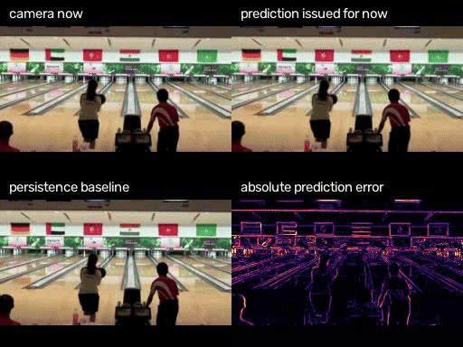
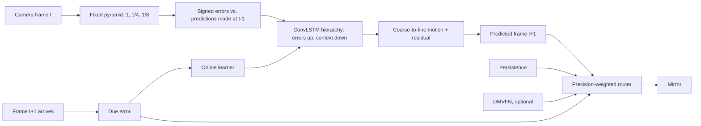

# Cortical Mirror

A live mirror that shows what the camera will see next — and keeps learning to see while you stand in front of it.

A small predictive-coding hierarchy predicts the next webcam frame from the frames it has already seen. Every prediction is scored only against the frame it was issued for, and that error is the only teaching signal: offline on natural video, and online, continuously, on the camera stream in front of it. Started from random weights, it begins as an exact copy of the last frame. On a person moving in front of a still camera it learns, within about a minute, to predict better than that copy; on short, generic action clips it ends about even with it.



<sub>Sample footage: “FFSb – Corona LSFB” by the Fédération Francophone des Sourds de Belgique, [CC BY 3.0](https://creativecommons.org/licenses/by/3.0/), via [Wikimedia Commons](https://commons.wikimedia.org/wiki/File:FFSb_-_Corona_LSFB.webm); shown mirrored and as predicted. See [`THIRD_PARTY_NOTICES.md`](THIRD_PARTY_NOTICES.md).</sub>

**Scientific scope:** a functional predictive-coding architecture, not a claim of biological cortical simulation or of machine consciousness.

## What you see

- **The mirror** fills the screen with the *predicted* next frame, flipped like a mirror. The real camera is only a small inset.
- **The surprise curve** plots the mirror's prediction error over minutes against simply repeating the last frame. Started from scratch, you watch it fall below that line.
- **Close its eyes** (space): the camera is cut off and the hierarchy runs on its own predictions. Watch how long its imagined future holds before it drifts; the surprise curve shades those seconds.
- **Look ahead** (1 to 5): show the prediction that many frames into the future, to cancel camera and display latency.
- **What it relies on** (T): colour each region by the predictor the router trusts there, or by the motion the hierarchy expects.
- **Lab view** (Tab): camera, prediction, surprise map, and overlay side by side.

## Prior work, and what is new here

The architecture is a member of a well-known family, and it should be read that way.

- **Rao & Ballard (1999)**, *Predictive coding in the visual cortex*: higher areas predict lower-area activity; only the residual error is passed up.
- **Friston (2005, 2010)**, the free-energy formulation, and **Feldman & Friston (2010)**, *Attention, uncertainty, and free-energy*: prediction errors are weighted by their expected **precision**, i.e. how much each signal should be trusted.
- **PredNet — Lotter, Kreiman & Cox (2017)**, *Deep predictive coding networks for video prediction and unsupervised learning*: a convolutional-LSTM hierarchy in which each layer predicts its input and forwards signed (ReLU-split) errors upward while representations send top-down context. Our `CorticalFlowNet` follows this layout closely.
- **DMVFN — Hu et al. (CVPR 2023)**: a pretrained multi-scale voxel-flow predictor used here as one optional expert, credited in [`THIRD_PARTY_NOTICES.md`](THIRD_PARTY_NOTICES.md).

What this project adds, and tests:

1. **Upper levels that cannot collapse.** In PredNet-style models the target of level *l* is a learned transform of the error below it, so a network can shrink the target to make its own error vanish. Here each level's target is a fixed image pyramid; the three levels must predict the next frame at full, 1/4, and 1/8 resolution. A test asserts the targets have no parameters.
2. **Prediction by motion, coarse to fine.** Every level outputs a displacement increment that refines the coarser level's motion; the image is rendered by warping what was already seen, plus a bounded residual. An untrained network is therefore *exactly* persistence, and anything better than persistence had to be learned.
3. **Learning while it runs.** A background learner trains on windows replayed from the last ten seconds of camera input, with the same due-error loss, and copies improved weights into the live network between frames. A guard rolls back to the last good weights when replayed or live error climbs far above persistence. This is what lets the system learn to see *from scratch* in front of an audience; what made long runs stable was bounding the cell state and training from a settled state (burn-in), and the guard only caps the worst cases (see below).
4. **Precision-weighted routing.** Each 16 px region estimates, from recent due errors only, how reliable each predictor is, and mixes their forecasts by a softmax over that precision. This is test-time precision weighting in Feldman & Friston's sense, made visible by the trust overlay.
5. **Honest timing.** Nothing ever sees the frame it predicts. Evaluation pairs each prediction with exactly its target frame; tests check this with counterfactual futures.

## Results

All numbers come from files in [`reports/`](reports/), produced by the commands under [Evaluation](#evaluation).

### Test set

Official UCF101 split-1 **test** groups (groups 1–7), 2 videos per action class = 202 videos, 32 frames each, **6,262 scored transitions** at 256×192. UCF101 clips in one group are cut from the same source video, so train, validation (groups 8–9), and test share no source video. Checkpoints and router settings were chosen on validation only. Every engine in the table was scored once in its final form; in addition, a mid-training snapshot of the final model was scored once (`reports/test-G-ep1-*`), the two baseline routers were first scored with the earlier, untuned settings before being re-scored with the validation-tuned ones shown here, and the live-learning settings below were developed on six test scenes, which is why the live-learning results use twelve different ones. MAE is normalized pixel error and LPIPS (Zhang et al., 2018) a learned perceptual distance; lower is better for both.

| Engine | MAE ↓ | vs. persistence | SSIM ↑ | LPIPS ↓ | Transitions beating persistence |
|---|---:|---:|---:|---:|---:|
| Repeat the last frame (persistence) | 0.01806 | — | 0.9027 | 0.0333 | — |
| Classical optical flow, Farnebäck | 0.01945 | -7.7% | 0.8930 | 0.0720 | 32.6% |
| DMVFN, pretrained third-party model | 0.01649 | +8.7% | 0.9152 | 0.0328 | 61.4% |
| **Cortical hierarchy alone** | 0.01494 | +17.3% | 0.9259 | 0.0325 | 69.7% |
| Router: persistence + flow | 0.01662 | +7.9% | 0.9141 | 0.0409 | 58.5% |
| Router: persistence + DMVFN | 0.01502 | +16.8% | 0.9254 | 0.0324 | 67.2% |
| **Router: persistence + cortical** | 0.01481 | +18.0% | 0.9260 | 0.0322 | 75.1% |
| Router: cortical + DMVFN | 0.01459 | +19.2% | 0.9291 | 0.0333 | 69.2% |
| **Router: persistence + cortical + DMVFN** | 0.01443 | +20.1% | 0.9295 | 0.0331 | 73.3% |

The hierarchy has 720 k parameters, learned only by predicting UCF101 video. Alone, it predicts with 17.3% less error than persistence, about twice the 8.7% of the pretrained DMVFN. That gap is solid: 8.6 points, with a paired-bootstrap 95% interval of 5.4 to 12.2 points over videos, and lower error on 133 of 202 videos (`reports/compare-cortical-vs-dmvfn.json`). DMVFN was trained on Vimeo-90K, not UCF101, so some of its deficit may be domain shift. Routed with persistence and no third-party model at all, the hierarchy is level with persistence + DMVFN: 1.2 points ahead, but the interval (−0.1 to 2.4 points) includes zero and it wins on 123 of 202 videos (`reports/compare-copy-cortical-vs-copy-dmvfn.json`). Adding DMVFN on top still helps a little. Perceptual distance barely moves for any method: one-frame warps soften fine texture, and LPIPS penalises that about as much as it rewards correct motion.

On an RTX 3090 the hierarchy alone took 3.1 ms per frame in the benchmark above. Fed at camera rate, the three-expert mirror takes 11.3 ms per frame without learning and 17.1 ms while the learner runs about 14 steps per second beside it (`reports/latency-rtx3090.json`). On a 12-thread laptop CPU (AMD Ryzen AI 9 HX 370 w/ Radeon 890M) the trained hierarchy with persistence takes 31.5 ms per frame (`reports/latency-laptop-cpu.json`). Router temperature and adaptation were chosen on the validation split (`reports/tune/`), and every router above uses the same settings.

### Learning from scratch, live

`tools/live_learning.py` chains consecutive clips of one test-set source video (18–66 s of one scene) and feeds them, frame by frame, to an **untrained** hierarchy that learns online from replayed windows of the stream. It steps the learner synchronously at 0.5 steps per frame; the live mirror sustains 0.6–0.7 on an RTX 3090 (`reports/latency-rtx3090.json`). Ratios are the mirror's error divided by the error of repeating the last frame, per 150-frame window (6 s at UCF101's 25 fps); below 1 is better than persistence. These twelve scenes were never used while developing the learner (`--offset 6 --scenes 12`).

| Scene (test split) | Footage | First window | Last window | Second half | Rollbacks | Second half without guard |
|---|---:|---:|---:|---:|---:|---:|
| BasketballDunk g01 | 18 s | 1.06 | 0.94 | 0.95 | 0 | 0.98 |
| BenchPress g02 | 24 s | 1.08 | 0.91 | 0.93 | 0 | 0.93 |
| Biking g02 | 50 s | 1.03 | 1.01 | 1.00 | 0 | 1.00 |
| Billiards g02 | 66 s | 1.65 | 1.04 | 1.16 | 19 | 1.04 |
| BlowDryHair g06 | 48 s | 1.02 | 0.99 | 0.98 | 0 | 0.99 |
| BlowingCandles g06 | 36 s | 1.19 | 0.91 | 0.93 | 0 | 0.92 |
| Bowling g01 | 36 s | 0.98 | 0.99 | 0.96 | 0 | 0.97 |
| BoxingPunchingBag g01 | 42 s | 1.24 | 0.92 | 0.92 | 1 | 0.88 |
| BoxingSpeedBag g04 | 54 s | 1.06 | 1.34 | 1.30 | 0 | 1.47 |
| BrushingTeeth g02 | 66 s | 1.67 | 1.68 | 1.27 | 4 | 2.77 |
| CliffDiving g05 | 18 s | 1.02 | 0.78 | 0.95 | 0 | 1.16 |
| CricketBowling g01 | 24 s | 1.47 | 1.02 | 1.07 | 0 | 1.09 |
| **All twelve, pooled** | | | | **1.02** | | **1.06** |

The frozen untrained network scores exactly 1.00 on every window: it *is* persistence. Learning only from these short, varied action clips, it ends about even with persistence (1.02 pooled) and better on 7 of 12 scenes. The six scenes used during development looked better (0.95 pooled, `reports/live-scratch-realtime-lr1e-3.json`), which is exactly why the held-out numbers are the ones reported.

Long continuous runs were made stable by bounding the cell state and training from a settled state: before those changes one development scene diverged to 6× persistence error **without triggering a single rollback** (`reports/live-scratch-guard.json`). The guard is a safety net, not the fix. With it off (last column, `reports/live-scratch-heldout-noguard.json`), the worst scene reaches 2.8× instead of 1.3× and the pooled ratio is 1.06; on one scene (Billiards) its 19 rollbacks made things worse.

**The sample clip is where it works.** On the 22-second sign-language clip that ships with the release (a person facing a still camera), `tools/live_learning.py --video sample.mp4 --loop 3` measures 1.11× persistence error in the first 6 s, 0.87× by the end of the first pass (19 s), and 0.72–0.76× after about a minute, by which point the learner has seen the clip repeat (`reports/live-scratch-sample.json`).

**After pretraining, live learning adds little on these clips.** The trained hierarchy, frozen, is 23% below persistence on the same continuous scenes and stays stable for over a thousand frames; fine-tuning it live for 20–35 s changes that by less than one percentage point (`reports/live-pretrained-G*.json`). Its value is adapting to what UCF101 does not contain — a particular room, camera, and lighting — which needs the webcam test set below to measure.

### The panning test

`tools/pan_probe.py` slides a natural-statistics texture 3 px per frame to the right and reads off the motion the hierarchy predicts. Version 0.1 predicted about 0.05 px — effectively a copy of the last frame.

| | Predicted motion | Error vs. persistence |
|---|---:|---:|
| v0.1 cortical network | ≈ 0.05 px | ≈ equal |
| v0.2 cortical network | **1.75 px** of 3 px | **47% lower** |

It underestimates a 3 px pan, plausibly because typical UCF101 motion at this resolution is about 1 px per frame (validation teacher flow averages 1.1 px).

## A cortex that learns to see (research track)

The mirror above is good engineering: a network trained by backpropagation on 8,000 videos. It is not how a brain learns. This research track asks a different question, in the spirit of "something that learns to see like cortex from scratch": can a predictive-coding hierarchy that learns **only with local rules** develop what a real visual cortex is known to do, by itself?

Progress is judged by **phenomena that emerge**, measured with the stimuli neuroscience used. Each protocol is written down in [`docs/protocols/`](docs/protocols/) before its first measurement, with its pass criterion, and failures are reported. Nothing is fitted to brain recordings.

### The rules

1. **No backpropagation, and no weight transport.** Every connection changes by the product of the activities at its two ends and the error its cell carries. Feedback weights never read the forward weights. They start unrelated and converge by receiving the same local update (Kolen & Pollack, 1994). The code never uses automatic differentiation, and a test enforces it.
2. **Innate structure only where biology has it at birth.**
   - Built in: a retina-like front end (centre-surround ON/OFF cells, contrast normalisation, lagged cells), small receptive fields, a coarse-to-fine layout, homeostatic set points, and the reflex "look toward surprise".
   - Not built in: edge filters, orientations, directions, or where to look.
3. **The newborn learns only from its own stream, and the adult learns with exactly the same rules.** In 3 hours of training, each adult watched 36–121 hours of UCF101 training video (25 fps): 121 h in phase 1, 77 h in phase 2, 36 h in phase 3. Later phases are slower per step.
4. **Phenomena are measured, not eyeballed**, with criteria fixed in advance.
5. **Edge cells are a first check, not the result.** Many learning methods produce them.

**Declared simplification:** weights are shared across positions (convolution). That is like every location learning from the same statistics, rather than each one learning separately as in biology.

### What it is

- **Retina.** Luminance at 128 × 96 becomes an ON/OFF code. From phase 2 it also has lagged cells, which carry the previous frame.
- **V1.** 32 cell types settle to explain the retinal code with as few active cells as possible (sparse coding; Olshausen & Field, 1996).
- **V2** (from phase 2). V2 learns to predict V1, and V1 is pulled toward that prediction (Rao & Ballard, 1999).
- **Temporal prediction.** Every level predicts its own next activity, learning by a normalised delta rule.
- **Eye** (phase 3). The cortex sees a foveal window of a larger view. A coarse periphery, learning by the same rules, signals surprise, and the eye saccades toward it, avoiding recent fixations. Each movement has its own learned temporal kernel. The cortex is told which movement is about to happen (an efference copy), but nothing about the resulting image shift is built in.

Two instances of the same network run as **twin mirrors**: a **newborn** that starts blank in front of the camera, and an **adult**. Watching the newborn's cells turn into the adult's is the demo.

### Results

| Phenomenon (protocol) | Verdict |
|---|---|
| Orientation-tuned cells, like V1 (1) | **Emerges.** The newborn reaches 88–94% selective cells within 2 minutes of video; the adult 97%. |
| Repetition suppression and mismatch (2) | **Emerges,** with a caveat: an untrained network that learns during the sequence already shows much of it. |
| Direction-selective cells (3) | **Fails.** Learning removes the few the untrained network has. |
| Surround suppression from feedback (4) | **Fails.** Suppression is strong, but just as strong without feedback, so it comes from competition within V1. |
| End-stopping from feedback (5) | **Fails,** for the same reason. |
| Predictive remapping with an efference copy (6) | **Emerges in the adult.** Prediction error after a saccade drops to 0.40 with the copy, and the kernels are direction-specific (0.51). |
| Habituation of orienting (7) | **Fails.** The eye stays drawn to predictable motion. Inhibition of return works (revisits 0.00 vs 0.20 by chance). |

The tables below are generated from the report files by `tools/cortex_report.py`, which applies each protocol's pre-declared criterion.

#### Phase 1, protocol 1: orientation tuning

| Condition | Median OSI | Cells with OSI > 0.3 | Protocol 1 |
|---|---:|---:|---|
| Untrained | 0.09 | 38% | – |
| Newborn, 2 min of the sample clip | 0.48 | 88% | pass |
| Newborn, 2 min of a held-out UCF101 scene | 0.64 | 94% | pass |
| Adult | 0.74 | 97% | pass |

#### Phase 1, protocol 2: oddball adaptation

| Condition | iRS (repetition suppression) | iPE (prediction error) | iMM (mismatch) | Protocol 2 |
|---|---:|---:|---:|---|
| Untrained | +0.32 | +0.31 | +0.63 | – |
| Newborn, 2 min of the sample clip | +0.45 | +0.34 | +0.80 | pass |
| Newborn, 2 min of a held-out UCF101 scene | +0.45 | +0.34 | +0.79 | pass |
| Adult | +0.44 | +0.33 | +0.77 | pass |

#### Phase 2, protocol 3: direction selectivity

| Condition | Median DSI | Cells with DSI > 0.3 | Protocol 3 |
|---|---:|---:|---|
| Untrained | 0.12 | 19% | – |
| Newborn, 2 min of the sample clip | 0.07 | 9% | **fail** |
| Newborn, 2 min of a held-out UCF101 scene | 0.00 | 0% | **fail** |
| Adult | 0.01 | 0% | **fail** |

#### Phase 2, protocol 4: surround suppression

| Condition | Median index with feedback | Without feedback | Difference | Protocol 4 |
|---|---:|---:|---:|---|
| Untrained | 0.18 | 0.10 | +0.08 | – |
| Newborn, 2 min of the sample clip | 0.66 | 0.66 | -0.00 | – |
| Newborn, 2 min of a held-out UCF101 scene | 0.65 | 0.65 | -0.00 | – |
| Adult | 0.67 | 0.67 | -0.00 | **fail** |

#### Phase 2, protocol 5: end-stopping

| Condition | Median index with feedback | Without feedback | Difference | Protocol 5 |
|---|---:|---:|---:|---|
| Untrained | 0.12 | 0.08 | +0.05 | – |
| Newborn, 2 min of the sample clip | 0.37 | 0.38 | -0.01 | – |
| Newborn, 2 min of a held-out UCF101 scene | 0.32 | 0.32 | -0.00 | – |
| Adult | 0.30 | 0.31 | -0.00 | **fail** |

#### Phase 3, protocol 6: predictive remapping

| Condition | Remapping ratio (below 1: the copy helps) | Direction specificity (below 1: direction matters) | Protocol 6 |
|---|---:|---:|---|
| Untrained | 1.000 | 1.000 | – |
| Newborn, 2 min of the sample clip | 1.171 | 0.992 | – |
| Newborn, 2 min of a held-out UCF101 scene | 1.038 | 0.992 | – |
| Adult | 0.399 | 0.511 | pass |

#### Phase 3, protocol 7: habituation of orienting

| Condition | Dwell on onsets, first 200 frames | Last 300 frames | Revisits vs chance | Protocol 7 |
|---|---:|---:|---:|---|
| Control: untrained, not learning | 0.00 | 0.00 | 0.00 vs 0.21 | – |
| Untrained, learning (a newborn) | 0.00 | 0.00 | 0.00 vs 0.20 | **fail** |
| Newborn, 2 min of the sample clip | 0.00 | 0.00 | 0.00 vs 0.20 | **fail** |
| Newborn, 2 min of a held-out UCF101 scene | 0.00 | 0.00 | 0.00 vs 0.21 | **fail** |
| Adult | 0.00 | 0.00 | 0.00 vs 0.20 | **fail** |

**Why the failures, as diagnosed:**
- **Direction selectivity.** In ordinary footage, one frame barely differs from the next. Local learning therefore gives each cell the same weights for the current and the lagged image, which cancels any direction preference.
- **Surround suppression and end-stopping.** V2 learned to predict V1 almost exactly (mean prediction 0.0064 vs V1's 0.0070). So the top-down error is near zero for small and large stimuli alike, and feedback cannot suppress the predictable surround more than the centre.
- **Habituation of orienting.** Within the test's 30 seconds, the periphery does not learn to predict a steady pan well enough to lose interest in it, and neither does the adult's.

**Why the remapping result is real:** each learned movement kernel places its weight in the direction that maps the old view onto the new one. That holds for all eight movements: rightward +0.68 in x, upward −0.67 in y, and about ±0.6 on both axes for the diagonals. "No movement" stays centred. A direction control (the opposite movement's kernel) rules out kernels that merely dampen activity.

As a mirror, this cortex is **worse than simply repeating the last frame**: the adults' training logs show 1.3–2× the error in their own retinal code. One newborn reached 0.85× on the sample clip. It is about equal to its own "nothing changes" expectation. The v0.2 mirror above remains the one to use for prediction. This track is about how seeing develops, not about pixel accuracy.

### Run it

```bash
# Twin mirrors: a newborn beside an adult, both watching your camera (N restarts the newborn).
# The adult is downloaded from the v0.3.0 release on first use; --phase 2 or 3 picks a later one.
.venv/bin/cortical-mirror twins
.venv/bin/cortical-mirror twins --adult checkpoints/cortex-adult-p1.pt   # your own adult

# Raise an adult with the same rules (about 3 h on one RTX 3090)
.venv/bin/python tools/train_cortex.py --data data/ucf101/UCF-101 --phase 1 --hours 3 \
  --output checkpoints/cortex-adult-p1.pt --log reports/cortex/train-p1.jsonl

# Measure the phenomena, as a newborn raised on a clip or as a saved adult
.venv/bin/python tools/phenomena.py --untrained --phase 1 --experience clip.mp4 \
  --output reports/cortex/phase1-newborn.json
.venv/bin/python tools/phenomena.py --checkpoint checkpoints/cortex-adult-p1.pt \
  --output reports/cortex/phase1-adult.json
.venv/bin/python tools/cortex_report.py
```

Phases 2 and 3 use `--phase 2` and `--phase 3` (V2; then the eye). The three adults are in the [v0.3.0 release](https://github.com/froid1911/cortical-mirror/releases/tag/v0.3.0): 121, 77 and 36 hours of UCF101 for phases 1, 2 and 3.

### References for this track

- D. H. Hubel and T. N. Wiesel. Receptive fields, binocular interaction and functional architecture in the cat's visual cortex. *J. Physiol.* 160, 1962. And: Receptive fields and functional architecture in two nonstriate visual areas (18 and 19) of the cat. *J. Neurophysiol.* 28, 1965.
- B. A. Olshausen and D. J. Field. Emergence of simple-cell receptive field properties by learning a sparse code for natural images. *Nature* 381, 1996.
- J. F. Kolen and J. B. Pollack. Backpropagation without weight transport. *IEEE ICNN*, 1994.
- J. H. van Hateren and D. L. Ruderman. Independent component analysis of natural image sequences yields spatio-temporal filters similar to simple cells in primary visual cortex. *Proc. R. Soc. B* 265, 1998.
- J. R. Cavanaugh, W. Bair and J. A. Movshon. Nature and interaction of signals from the receptive field center and surround in macaque V1 neurons. *J. Neurophysiol.* 88, 2002.
- M. Zhu and C. J. Rozell. Visual nonclassical receptive field effects emerge from sparse coding in a dynamical system. *PLoS Comput. Biol.* 9, 2013.
- G. G. Parras et al. Neurons along the auditory pathway exhibit a hierarchical organization of prediction error. *Nature Communications* 8, 2017.
- J.-R. Duhamel, C. L. Colby and M. E. Goldberg. The updating of the representation of visual space in parietal cortex by intended eye movements. *Science* 255, 1992.
- M. A. Sommer and R. H. Wurtz. Influence of the thalamus on spatial visual processing in frontal cortex. *Nature* 444, 2006.
- E. N. Sokolov. *Perception and the Conditioned Reflex*. Pergamon, 1963.
- L. Itti and P. Baldi. Bayesian surprise attracts human attention. *Vision Research* 49, 2009.

## Setup

You need a computer with a webcam, about 1 GB of free disk space, and internet access the first time. An NVIDIA GPU is optional: without one, the mirror runs on the CPU (see [What to expect](#what-to-expect)).

### macOS

1. Open **Terminal** and install Apple's command-line tools, which include `git` (skip this if `git --version` already works):
   ```bash
   xcode-select --install
   ```
2. Install [`uv`](https://docs.astral.sh/uv/), which also provides Python, then **open a new Terminal window**:
   ```bash
   curl -LsSf https://astral.sh/uv/install.sh | sh
   ```
3. Download the project and install it:
   ```bash
   git clone https://github.com/froid1911/cortical-mirror.git
   cd cortical-mirror
   uv venv --python 3.12
   uv pip install --python .venv/bin/python -e .
   ```
4. Start the mirror:
   ```bash
   .venv/bin/cortical-mirror demo
   ```
5. The first time, macOS asks whether Terminal may use the camera: click **Allow**. If you missed the prompt, enable Terminal under **System Settings → Privacy & Security → Camera** and run the command again. Without camera access, the mirror plays a sample clip instead.
6. Open **http://127.0.0.1:8080** in a browser on the same Mac.

### Linux

```bash
curl -LsSf https://astral.sh/uv/install.sh | sh      # then open a new terminal
git clone https://github.com/froid1911/cortical-mirror.git
cd cortical-mirror
uv venv --python 3.12
uv pip install --python .venv/bin/python -e .
.venv/bin/cortical-mirror demo
```

Open **http://127.0.0.1:8080**. On Linux the default PyTorch package includes NVIDIA CUDA support. With an NVIDIA GPU and a recent driver (`nvidia-smi` should list it), the mirror uses the GPU automatically. Add `'.[dev,eval]'` instead of `.` to the install command to run the tests and benchmarks.

### What to expect

`demo` opens camera 0 and starts the hierarchy **untrained**: it begins as an exact copy of the last frame and learns from what it sees, routed only against persistence, so everything the mirror predicts was learned on the spot. `demo --pretrained` instead starts from the trained weights. Files it needs (the trained weights, DMVFN, a sample clip) are downloaded from the [v0.2.0 release](https://github.com/froid1911/cortical-mirror/releases/tag/v0.2.0) to `~/.cache/cortical-mirror` on first use.

| | With an NVIDIA GPU | Without (any Mac, or a PC without one) |
|---|---|---|
| `demo` (from scratch) | Learns live; on a person moving in front of the camera it pulls ahead of persistence within about a minute | Learns, but at under one step per second: expect many minutes |
| `demo --pretrained` | Trained hierarchy, DMVFN, and persistence, with live learning | Trained hierarchy and persistence; live learning off |

Macs run on the CPU because the project does not yet use Apple's GPU (it has not been measured on a Mac). The mirror itself runs on the CPU; live learning is what needs the GPU.

Without a camera, it plays a 22-second sample clip of a person signing in Belgian French Sign Language, chosen because it looks like someone standing in front of a mirror. On a GPU, an untrained hierarchy learns to predict it better than persistence within its first pass, and about 25% better after a minute of looping (see [Learning from scratch, live](#learning-from-scratch-live)).

```bash
.venv/bin/cortical-mirror demo --pretrained       # start from the trained weights instead
.venv/bin/cortical-mirror demo --source clip.mp4  # any video file instead of the camera
.venv/bin/cortical-mirror demo --source 1         # a second camera
.venv/bin/cortical-mirror demo --horizon 3        # show three frames ahead
```

Append `?view=lab` to the URL to open the lab view directly, for example on a second screen.

### Webcam on one machine, GPU on another

`--source` also accepts a network stream. To use a Linux laptop's camera with a GPU server you can reach over SSH, stream the camera's own MJPEG frames from the laptop, then forward the stream to the server and the page back to the laptop:

```bash
# On a Linux laptop whose webcam outputs MJPEG (tested setup)
ffmpeg -f v4l2 -input_format mjpeg -framerate 30 -video_size 640x480 -i /dev/video0 \
  -c:v copy -f mjpeg "tcp://127.0.0.1:9000?listen=1" &
ssh -tt -L 8080:127.0.0.1:8080 -R 9000:127.0.0.1:9000 gpu-server \
  'cd cortical-mirror && .venv/bin/cortical-mirror demo --source tcp://127.0.0.1:9000'
```

Then open **http://127.0.0.1:8080** on the laptop.

### Controls

| Key | Action |
|---|---|
| Space | Close or open its eyes |
| T | Show what it relies on |
| 1–5 | Look that many frames ahead |
| L | Pause or resume learning |
| R | Forget what it learned here |
| Tab | Switch between mirror and lab view (twins first, with `twins`) |
| N | Restart the newborn (`twins`) |
| F | Full screen |

## Architecture



Each `CorticalFlowNet` level receives the positive and negative parts of its last prediction error, its current input, and the change since the last frame. Cell states are soft-bounded so that minutes of continuous input cannot drive them into saturation, and the network is trained from a recurrent state already settled on earlier frames ("burn-in"), the regime a live camera keeps it in.

## Engines

| Engine | Mechanism |
|---|---|
| `adaptive` | Precision-weighted routing between `--experts` (default `copy,cortical,dmvfn`; `flow` also available) |
| `cortical` | The predictive-coding hierarchy alone |
| `dmvfn` | Pretrained dynamic multi-scale voxel flow |
| `flow` | Classical Farnebäck optical flow, extrapolated |
| `copy` | Repeat the current frame: the required honesty baseline |

`--learn` keeps training the hierarchy on the stream; `--from-scratch` starts it untrained (and implies `--learn`). `--device auto` (the default) uses CUDA when present and the CPU otherwise.

```bash
.venv/bin/cortical-mirror serve --engine adaptive \
  --checkpoint ~/.cache/cortical-mirror/cortical.pt \
  --dmvfn-checkpoint ~/.cache/cortical-mirror/dmvfn_vimeo.pkl \
  --learn --source 0
```

## Evaluation

```bash
# Test split, one engine (repeat per engine / expert set)
.venv/bin/python tools/benchmark.py --data /path/to/UCF-101 --split test --lpips \
  --engine adaptive --experts copy,cortical,dmvfn \
  --checkpoint cortical.pt --dmvfn-checkpoint dmvfn_vimeo.pkl --output reports/test-adaptive.json

# Learning from scratch on the twelve held-out scenes (add --no-guard for the ablation)
.venv/bin/python tools/live_learning.py --data /path/to/UCF-101 --offset 6 --scenes 12 \
  --output reports/live-scratch-heldout.json

# Learning from scratch on the sample clip, looped three times
.venv/bin/python tools/live_learning.py --video sample.mp4 --loop 3 \
  --output reports/live-scratch-sample.json

# Paired bootstrap between two benchmark reports
.venv/bin/python tools/compare_reports.py reports/test-G-final-cortical.json reports/test-dmvfn.json

# Latency and learner throughput on this machine
.venv/bin/python tools/latency.py --checkpoint cortical.pt --dmvfn-checkpoint dmvfn_vimeo.pkl \
  --video sample.mp4 --output reports/latency.json

# The panning test
.venv/bin/python tools/pan_probe.py --checkpoint cortical.pt
```

`live_learning.py` defaults match the live mirror on CUDA (0.5 steps per frame, batch 2, burn-in 8, learning rate 1e-3 from scratch).

`benchmark.py` refuses `--learn`: the live learner runs on its own thread, so its effect is measured with `live_learning.py`, which steps it synchronously.

### Your own webcam test set

UCF101 is not a webcam. Record fresh clips before tuning anything on them, then score every engine on all of them:

```bash
.venv/bin/python tools/record.py --output data/webcam-test --clips 10 --seconds 10
.venv/bin/python tools/benchmark.py --data data/webcam-test --split all --frames 300 \
  --engine adaptive --checkpoint cortical.pt --dmvfn-checkpoint dmvfn_vimeo.pkl \
  --output reports/webcam-adaptive.json
```

## Training

UCF101 can be fetched through a mirror that documents conversion of the official archive without altering videos. The published SHA-256 is checked here:

```bash
mkdir -p data
curl -L -o data/UCF-101.zip \
  'https://huggingface.co/datasets/quchenyuan/UCF101-ZIP/resolve/main/UCF-101.zip?download=true'
echo 'eb77e54dfafd9c77e7b086f5e5ef7738cabd16a701b3f5c301a1f6c81fc4756e  data/UCF-101.zip' \
  | sha256sum -c -
unzip data/UCF-101.zip -d data/ucf101
```

Train the released model (8 epochs; 5.5 hours on one RTX 3090 that two other training runs shared, `reports/train-G-time.json`):

```bash
.venv/bin/cortical-train \
  --data data/ucf101/UCF-101 --output runs/cortical \
  --epochs 8 --batch-size 8 --workers 11 --lr 1e-3 \
  --frames 10 --burn-in 16 --clips-per-video 6 --validation-videos 512 \
  --channels 24,48,96 --width 256 --height 192
```

- The split assigns whole UCF101 groups: test = official split-1 test groups 1–7, validation = groups 8–9, train = the rest. The test split is never loaded by training.
- `--burn-in N` runs N frames without gradient before each training clip.
- `--flow-teacher W` adds a Farnebäck-flow distillation term that decays linearly to zero, so the final epochs are purely self-supervised. Validation always reports flow endpoint error against the teacher as a diagnostic of whether motion is being learned.
- The best checkpoint is selected on validation pixel MAE.
- Checkpoints load through PyTorch's restricted `weights_only` loader.

```bash
.venv/bin/pytest
.venv/bin/ruff check cortical_mirror tests tools mirror.py
```

Tests cover causal counterfactuals, forward-warp direction, the group-disjoint split, teacher-flow sign convention, non-collapsing targets, learning a pan from scratch (offline and online), rollback on divergence, bounded cell states over long runs, routing, timestamp alignment, and checkpoint round-trips.

## Limitations

- Only one-step prediction is scored. Multi-step rollouts ("eyes closed", look-ahead) are shown in the demo but not evaluated quantitatively.
- UCF101 is not a webcam, and the hierarchy is small and runs at 256×192. Live learning is meant to adapt to one room, but that has not yet been measured on webcam footage; record a test set with `tools/record.py`.
- From scratch, the hierarchy is briefly *worse* than persistence while its first motion estimates are wrong. Within 18–66 s of short, varied action footage it ends about even with persistence, better on 7 of 12 held-out scenes; it needs a person moving steadily in front of a still camera, like the sample clip, to pull clearly ahead within a minute.
- Live learning needs an NVIDIA GPU. On a CPU the learner manages under one step per second.
- There is no object permanence, explicit egomotion, or multimodal future; pixel warping and blending can soften detail.
- The pretrained DMVFN expert is not part of the self-organizing story; ablations without it are reported.

## Changes since v0.1

v0.1's evaluation split clips, not source videos, between training and validation, and its checkpoint and router settings were chosen on the reported videos; its "held-out" numbers were validation numbers on videos that shared sources with training. Its cortical network also predicted almost no motion (MAE 0.0199 vs 0.0199 for persistence; ~0.05 px on a 3 px pan), so the gains came from DMVFN and blending. v0.2 rebuilds the hierarchy, the split, the evaluation, and the demo around those findings.

## License and attribution

Project code is MIT licensed. DMVFN code and checkpoint attribution is preserved in [`THIRD_PARTY_NOTICES.md`](THIRD_PARTY_NOTICES.md). UCF101 is by Khurram Soomro, Amir Roshan Zamir, and Mubarak Shah, *UCF101: A Dataset of 101 Human Action Classes From Videos in the Wild*, CRCV-TR-12-01.

### References

- R. P. N. Rao and D. H. Ballard. Predictive coding in the visual cortex. *Nature Neuroscience* 2, 79–87, 1999.
- K. Friston. A theory of cortical responses. *Phil. Trans. R. Soc. B* 360, 815–836, 2005.
- K. Friston. The free-energy principle: a unified brain theory? *Nature Reviews Neuroscience* 11, 127–138, 2010.
- H. Feldman and K. Friston. Attention, uncertainty, and free-energy. *Frontiers in Human Neuroscience* 4, 215, 2010.
- W. Lotter, G. Kreiman, and D. Cox. Deep predictive coding networks for video prediction and unsupervised learning. *ICLR*, 2017.
- X. Hu, Z. Huang, A. Huang, J. Xu, and S. Zhou. A dynamic multi-scale voxel flow network for video prediction. *CVPR*, 2023.
- R. Zhang, P. Isola, A. A. Efros, E. Shechtman, and O. Wang. The unreasonable effectiveness of deep features as a perceptual metric. *CVPR*, 2018.
- G. Farnebäck. Two-frame motion estimation based on polynomial expansion. *SCIA*, 2003.
